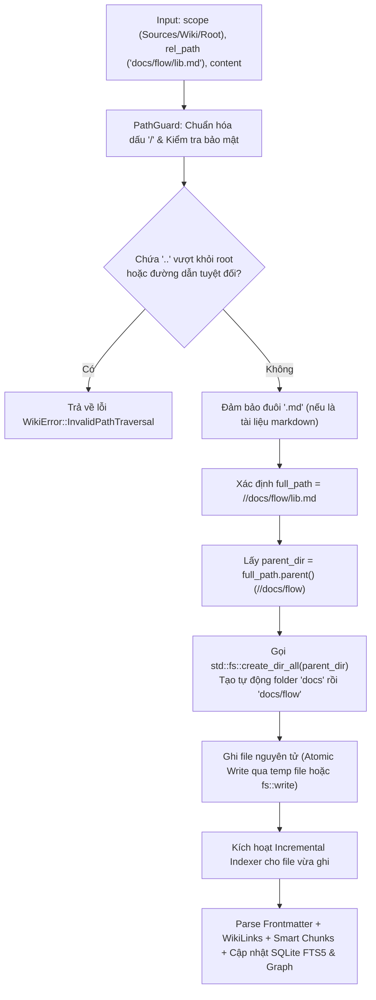
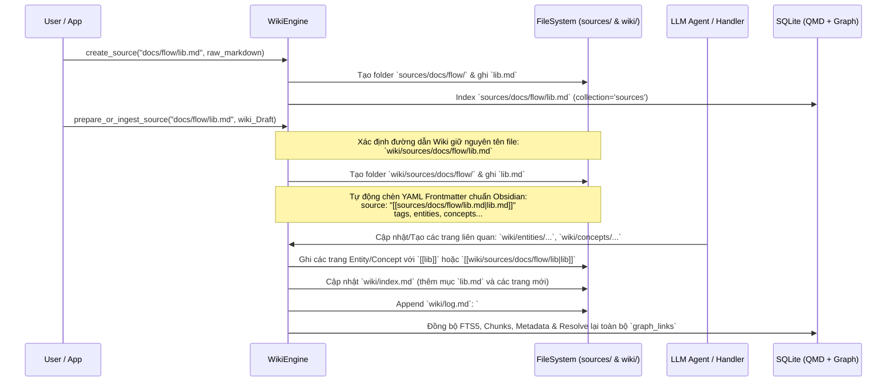
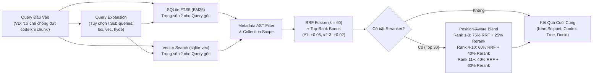

# Tài Liệu Kiến Trúc & Đặc Tả Triển Khai: `llm-wiki-rs`

> [!IMPORTANT]
> Tài liệu này là **Blueprint Kỹ Thuật Toàn Diện (Agent-Ready Specification)** kết hợp mô hình **LLM Wiki** của Andrej Karpathy ([Gist `442a6bf555914893e9891c11519de94f`](https://gist.github.com/karpathy/442a6bf555914893e9891c11519de94f)) và kiến trúc tìm kiếm **QMD (Query Markup Documents)** ([`tobi/qmd`](https://github.com/tobi/qmd)), đồng thời tương thích 100% với **Obsidian Graph View**. Một AI Coding Agent hoặc Rust Developer có thể dùng trực tiếp tài liệu này để triển khai toàn bộ crate từ đầu đến cuối.

---

## 1. Tổng Quan Triết Lý & Mục Tiêu Thiết Kế

### 1.1. Sự kết hợp giữa LLM Wiki (Karpathy) và QMD
Thay vì RAG truyền thống (chỉ cắt nhỏ tài liệu thô và tìm kiếm lại từ đầu ở mỗi câu hỏi mà không tích lũy tri thức), **`llm-wiki-rs`** vận hành theo cơ chế **Persistent Compounding Wiki**:
1. **3 Tầng Dữ Liệu (Three Layers)**:
   - **`sources/` (Raw Sources)**: Tập hợp tài liệu gốc (bài báo, tài liệu kỹ thuật, ghi chú thô, hình ảnh). Tầng này mang tính bất biến đối với LLM (LLM chỉ đọc để tổng hợp, không tự ý sửa đổi nội dung gốc).
   - **`wiki/` (The Wiki)**: Thư mục chứa các file Markdown do LLM biên soạn và duy trì (trang tóm tắt source, trang thực thể `entities`, khái niệm `concepts`, bài phân tích tổng hợp `syntheses`, cùng 2 file điều phối trung tâm là `index.md` và `log.md`).
   - **`SCHEMA.md` (The Schema)**: Quy ước cấu trúc, frontmatter, quy tắc liên kết `[[WikiLinks]]` và workflow cho LLM khi thực hiện 3 tác vụ cốt lõi: **Ingest**, **Query**, và **Lint**.
2. **Động cơ xử lý & tìm kiếm QMD**:
   - **Smart Markdown Chunking**: Cắt chunk (~900 tokens, 15% overlap) dựa trên hệ thống chấm điểm ranh giới ngữ nghĩa (Heading H1–H6, Code Fence protection, Horizontal Rule, Paragraph) và suy giảm theo khoảng cách bình phương.
   - **Hybrid Search Pipeline**: Kết hợp **SQLite FTS5 (BM25)** + **Vector Search (`sqlite-vec` / Cosine Similarity)** + **Reciprocal Rank Fusion (RRF, $k=60$)** có trọng số và thưởng hạng đầu (top-rank bonus) + **Position-Aware Reranker Blending**.
   - **Typed Frontmatter Metadata & AST Filter**: Đọc YAML frontmatter để đánh chỉ mục thuộc tính và lọc đệ quy theo biểu thức logic (`and`, `or`, `not`, `eq`, `in`, `all`, `gte`...).

### 1.2. Đáp Ứng 8 Yêu Cầu Cốt Lõi
| # | Yêu cầu | Giải pháp kiến trúc trong `llm-wiki-rs` |
|---|---|---|
| **1** | Tham khảo **QMD** logic xử lý & search markdown | Tích hợp Smart Chunking (900 tokens, 15% overlap, code-fence protection), SQLite FTS5 BM25, Vector Search, RRF Fusion ($k=60$), Context Tree và Metadata AST Filter. |
| **2** | Tương thích **Obsidian's Graph View** | Thư mục gốc chính là một Obsidian Vault. Sử dụng chuẩn `[[WikiLinks]]`, `[[target|Alias]]`, `#tags`, YAML Frontmatter chuẩn Obsidian Properties. Parse và lưu bảng đồ thị liên kết (`links`) trong SQLite. |
| **3** | Có **API đầy đủ** để giao tiếp với lib | Cung cấp struct trung tâm `WikiEngine` với đầy đủ các nhóm API: File/Folder CRUD, Tree API, Wiki Lifecycle (`ingest`, `query`, `lint`), Search API (`lex`, `vec`, `hybrid`), Graph API (`backlinks`, `orphans`, `graph`). |
| **4** | **Chỉ cần config folder lưu data** | Khởi tạo duy nhất với `WikiConfig::new("/path/to/data_root")`. Tự động tạo `sources/`, `wiki/`, `SCHEMA.md`, và lưu SQLite DB tại `.wiki/index.sqlite` nằm gọn bên trong `data_root`. |
| **5** | Có **Tool cho LLM** sử dụng | Cung cấp bộ JSON Schema chuẩn (tương thích OpenAI/Anthropic/MCP) và hàm điều phối `WikiEngine::execute_tool(name, args)` để bất kỳ LLM Agent nào gọi trực tiếp. |
| **6** | Tạo file tự động **tạo folder lồng nhau** | Mọi hàm ghi file nhận đường dẫn tương đối như `"docs/flow/lib.md"` sẽ kiểm tra bảo mật (chống path traversal `..`), tự động tạo chuỗi thư mục cha (`docs/flow/`) trước khi ghi file và đánh index. |
| **7** | API lấy **cây thư mục** của `sources`, `wiki`,... | API `get_tree()` trả về cấu trúc đệ quy `FileTreeNode` (hỗ trợ lọc theo `sources`, `wiki`, hoặc đường dẫn con bất kỳ, kèm hàm render ASCII tree cho LLM). |
| **8** | **File name wiki trùng với file name ở source** | Khi ingest hoặc tạo wiki cho một source (VD: `sources/ai/rag-system.md` hoặc `sources/rust-guide.md`), trang tóm tắt trong `wiki/` giữ nguyên tên file gốc (`wiki/sources/ai/rag-system.md` hoặc `wiki/sources/rust-guide.md`), **tuyệt đối không dùng ID tự sinh** như `wiki_8f9a1b.md`. |

---

## 2. Cấu Trúc Thư Mục Dữ Liệu (Data Folder Layout) & Cấu Hình

Người dùng chỉ cần truyền duy nhất 1 đường dẫn `data_root` (ví dụ `/Users/me/my-knowledge-base`). Khi khởi tạo `WikiEngine::open(config)`, thư viện tự động khởi tạo cấu trúc chuẩn Obsidian Vault như sau:

```text
<data_root>/                          # Mở trực tiếp thư mục này bằng Obsidian
├── .wiki/                            # Thư mục hệ thống nội bộ (ẩn với Obsidian Graph)
│   ├── index.sqlite                  # SQLite DB (FTS5 + Vector + Graph Links + Metadata)
│   ├── index.sqlite-wal              # SQLite WAL file
│   └── models/                       # (Tuỳ chọn) Cache local GGUF / ONNX embedding models
├── .obsidian/                        # (Tuỳ chọn) Cấu hình Obsidian Vault (graph.json, app.json)
├── SCHEMA.md                         # Quy ước cấu trúc & hướng dẫn workflow cho LLM Agent
├── sources/                          # Tầng 1: Raw Sources (Read-only đối với luồng tổng hợp)
│   ├── assets/                       # Hình ảnh, file đính kèm tải về local
│   └── docs/
│       └── flow/
│           └── lib.md                # File nguồn do user hoặc tool thêm vào
└── wiki/                             # Tầng 2: The Wiki (Do LLM biên soạn & duy trì)
    ├── index.md                      # Danh mục tổng hợp toàn bộ trang trong wiki
    ├── log.md                        # Nhật ký hoạt động theo thời gian (append-only)
    ├── sources/                      # Trang tóm tắt 1-1 giữ nguyên tên file từ `sources/`
    │   └── docs/
    │       └── flow/
    │           └── lib.md            # GIỮ NGUYÊN TÊN FILE "lib.md" & cấu trúc từ source!
    ├── entities/                     # Các trang Thực thể (người, dự án, thư viện, công ty...)
    │   └── rust.md
    ├── concepts/                     # Các trang Khái niệm / Kiến trúc / Thuật toán
    │   └── bm25-search.md
    └── syntheses/                    # Các bài phân tích sâu, so sánh, kết quả Query được lưu lại
        └── rag-vs-llm-wiki.md
```

### Quy tắc Ánh Xạ Tên File Source $\leftrightarrow$ Wiki (Yêu cầu #8)
1. **Không sinh ID ngẫu nhiên cho tên file**: Khi một file nguồn `sources/docs/flow/lib.md` được đưa vào quy trình Wiki Ingest:
   - Đường dẫn tương đối trong `sources/` là: `docs/flow/lib.md` (File stem: `lib`, File name: `lib.md`).
   - File Wiki tương ứng sẽ được đặt tại: `wiki/sources/docs/flow/lib.md` (hoặc `wiki/lib.md` nếu người dùng cấu hình phẳng `FlatSourceWiki`, mặc định khuyên dùng `MirrorSourcePath` là `wiki/sources/<rel_path>` để tránh trùng tên khi các thư mục con có file trùng tên, đồng thời giữ đúng tên file `lib.md`).
2. **Tương thích Obsidian WikiLink**:
   - Trong Obsidian, mỗi file `.md` là một Node trên Graph View có nhãn chính là tên file (`lib`).
   - Khi trang `wiki/sources/docs/flow/lib.md` liên kết tới thực thể `[[rust]]` hoặc khái niệm `[[bm25-search]]`, và có thuộc tính frontmatter `source_file: "[[sources/docs/flow/lib.md|lib.md (Raw Source)]]"` hoặc liên kết trực tiếp trong bài, Obsidian Graph View sẽ vẽ đường nối trực quan giữa **Source gốc** $\leftrightarrow$ **Trang Wiki Source** $\leftrightarrow$ **Entities / Concepts**.
3. **Định danh nội bộ `docid` của QMD**:
   - Để phục vụ tìm kiếm nhanh theo kiểu QMD (ví dụ `#a1b2c3`), mã băm ngắn 6 ký tự (`docid`) chỉ được lưu dưới dạng **cột metadata trong bảng `documents` của SQLite** và hiển thị kèm kết quả search, tuyệt đối **không** dùng làm tên file trên ổ cứng.

---

## 3. Kiến Trúc Module Của Crate Rust (`llm-wiki-rs`)

```text
llm-wiki-rs/
├── Cargo.toml
└── src/
    ├── lib.rs                # Public exports: WikiEngine, WikiConfig, types, errors
    ├── config.rs             # WikiConfig (chỉ cần data_root, tự suy ra các path con)
    ├── error.rs              # WikiError (thiserror)
    ├── fs/                   # Quản lý File System, Auto-mkdir, Tree Builder, Adaptive Read Budget
    │   ├── mod.rs
    │   ├── path_guard.rs     # Chống Path Traversal, chuẩn hóa đường dẫn
    │   ├── file_ops.rs       # write_nested_file, slice_lines_with_budget, AdaptiveReadBudget, slugify, vtt_to_text
    │   └── tree.rs           # get_tree() cho sources, wiki, all + ASCII renderer
    ├── markdown/             # Xử lý Markdown theo chuẩn Obsidian & QMD
    │   ├── mod.rs
    │   ├── frontmatter.rs    # Parse/Serialize YAML frontmatter + QMD typed metadata
    │   ├── parser.rs         # Trích xuất Title, Headings, Tags (#tag), WikiLinks ([[...]])
    │   └── chunker.rs        # QMD Smart Chunking (~900 tokens, 15% overlap, break scoring)
    ├── db/                   # Tầng lưu trữ SQLite (rusqlite + FTS5 + sqlite-vec)
    │   ├── mod.rs
    │   ├── schema.rs         # Khởi tạo bảng & migrations
    │   ├── index_store.rs    # CRUD bảng documents, chunks, links, metadata, contexts (hỗ trợ tìm theo aliases & số)
    │   └── filter_sql.rs     # Biên dịch MetadataFilter AST sang câu lệnh SQL
    ├── search/               # Động cơ tìm kiếm QMD
    │   ├── mod.rs
    │   ├── fts.rs            # BM25 Search qua SQLite FTS5
    │   ├── vector.rs         # Vector Search + Trait Embedder / Reranker
    │   ├── rrf.rs            # Reciprocal Rank Fusion (k=60) + Position-aware blend
    │   └── metadata.rs       # Metadata Discovery & Filtering
    ├── graph/                # Tương thích Obsidian Graph View
    │   ├── mod.rs
    │   ├── link_resolver.rs  # Giải quyết [[WikiLink]] theo chuẩn Shortest-path + Aliases của Obsidian
    │   └── analysis.rs       # Backlinks, Outgoing links, Orphans, Hubs, Broken links
    ├── prompts/              # Prompt Builders, Domain Templates & Multi-Subagent System Prompts
    │   ├── mod.rs
    │   ├── ingest.rs         # Prompt & block parsers cho luồng Ingest 2 pha
    │   ├── query_lint.rs     # Prompt cho Query, Synthesis & Semantic Lint
    │   ├── language.rs       # Nhận diện và chỉ thị ngôn ngữ đầu ra
    │   ├── templates.rs      # Bộ 5 Domain Templates (Research, Personal, Team, Course, Book)
    │   └── subagents.rs      # Bộ 4 Universal Multi-Subagent Prompts (root, source_collector, wiki_ingestor, wiki_curator)
    ├── wiki/                 # Nghiệp vụ LLM Wiki (Karpathy pattern)
    │   ├── mod.rs
    │   ├── ingest.rs         # Luồng Ingest source (giữ nguyên tên file source) & WriteTopicSourceRequest
    │   ├── index_md.rs       # Tự động đọc/cập nhật wiki/index.md & generate_compact_index_md
    │   ├── log_md.rs         # Append & parse wiki/log.md (`## [YYYY-MM-DD] op | title`)
    │   └── linter.rs         # Kiểm tra sức khỏe Wiki (Orphans, Broken links, Un-ingested...)
    └── tools/                # Tích hợp Tool Calling cho LLM / MCP (15 Tools)
        ├── mod.rs
        ├── definitions.rs    # JSON Schema của 15 tools & is_read_only_wiki_tool
        └── executor.rs       # execute_tool_call & execute_tool_call_with_budget (AdaptiveReadBudget)
```

### `Cargo.toml` Đề Xuất
```toml
[package]
name = "llm-wiki"
version = "0.1.0"
edition = "2021"
description = "Local-first LLM Wiki & QMD Hybrid Search Engine compatible with Obsidian Graph View"

[dependencies]
# Database & Search
rusqlite = { version = "0.32", features = ["bundled", "functions", "vtab"] }
sqlite-vec = "0.1"                   # Lưu trữ và truy vấn vector trực tiếp trong SQLite

# Serialization & Frontmatter
serde = { version = "1.0", features = ["derive"] }
serde_json = "1.0"
serde_yaml = "0.9"

# Markdown & Parsing
pulldown-cmark = "0.12"
regex = "1.11"
globset = "0.4"
walkdir = "2.5"

# Hashing, Time & Error Handling
blake3 = "1.5"
chrono = { version = "0.4", features = ["serde"] }
thiserror = "2.0"
unicode-normalization = "0.1"

# Async / Optional LLM & Embedding traits
async-trait = "0.1"
tokio = { version = "1.40", features = ["fs", "rt", "sync"], optional = true }
```

---

## 4. Thiết Kế Cơ Sở Dữ Liệu SQLite (QMD + Obsidian Graph Schema)

File SQLite được lưu tại `<data_root>/.wiki/index.sqlite`, bật chế độ `PRAGMA journal_mode = WAL;` và `PRAGMA foreign_keys = ON;`.

```sql
-- 1. Bảng quản lý ngữ cảnh theo đường dẫn (QMD Path Context Tree)
CREATE TABLE IF NOT EXISTS path_contexts (
    scope TEXT NOT NULL,              -- 'global', 'sources', 'wiki'
    path_prefix TEXT NOT NULL,        -- VD: '/', '/entities', '/docs/flow'
    description TEXT NOT NULL,        -- Mô tả ngữ cảnh trả về kèm kết quả search
    updated_at TEXT NOT NULL,
    PRIMARY KEY (scope, path_prefix)
);

-- 2. Bảng Documents (Lưu thông tin mọi file .md trong sources/ và wiki/)
CREATE TABLE IF NOT EXISTS documents (
    id INTEGER PRIMARY KEY AUTOINCREMENT,
    docid TEXT NOT NULL UNIQUE,       -- 6-char hash từ relative_path (VD: 'a1b2c3'), dùng cho QMD get #a1b2c3
    collection TEXT NOT NULL,         -- 'sources' hoặc 'wiki'
    rel_path TEXT NOT NULL UNIQUE,    -- Đường dẫn tương đối từ data_root (VD: 'sources/docs/flow/lib.md')
    scoped_path TEXT NOT NULL,        -- Đường dẫn tương đối trong collection (VD: 'docs/flow/lib.md')
    file_name TEXT NOT NULL,          -- Tên file có đuôi (VD: 'lib.md')
    file_stem TEXT NOT NULL,          -- Tên file không đuôi (VD: 'lib') -> Dùng để resolve [[lib]]
    title TEXT NOT NULL,              -- Tiêu đề (Lấy từ frontmatter 'title', hoặc H1 đầu tiên, hoặc file_stem)
    category TEXT,                    -- Với wiki: 'source_summary', 'entity', 'concept', 'synthesis', 'system'
    source_rel_path TEXT,             -- Nếu là bài wiki tóm tắt source, trỏ về 'sources/docs/flow/lib.md'
    content_hash TEXT NOT NULL,       -- BLAKE3 hash của toàn bộ nội dung file để kiểm tra thay đổi
    raw_body TEXT NOT NULL,           -- Nội dung markdown (đã tách YAML frontmatter)
    frontmatter_json TEXT,            -- Toàn bộ YAML frontmatter đã parse sang JSON
    byte_size INTEGER NOT NULL,
    line_count INTEGER NOT NULL,
    mtime_ms INTEGER NOT NULL,        -- Thời gian sửa đổi file trên đĩa
    indexed_at TEXT NOT NULL,
    needs_embedding INTEGER NOT NULL DEFAULT 1
);

CREATE INDEX IF NOT EXISTS idx_docs_collection ON documents(collection);
CREATE INDEX IF NOT EXISTS idx_docs_file_stem ON documents(file_stem);
CREATE INDEX IF NOT EXISTS idx_docs_source_rel ON documents(source_rel_path);

-- 3. Bảng FTS5 Full-Text Search (BM25) ở cấp độ Document & Chunk
CREATE VIRTUAL TABLE IF NOT EXISTS documents_fts USING fts5(
    docid UNINDEXED,
    rel_path UNINDEXED,
    collection UNINDEXED,
    title,
    headings,
    body,
    tags,
    tokenize = 'unicode61 remove_diacritics 2'
);

-- 4. Bảng Chunks (Phục vụ Smart Chunking ~900 tokens & Vector Search của QMD)
CREATE TABLE IF NOT EXISTS content_chunks (
    id INTEGER PRIMARY KEY AUTOINCREMENT,
    document_id INTEGER NOT NULL REFERENCES documents(id) ON DELETE CASCADE,
    seq INTEGER NOT NULL,             -- Thứ tự chunk: 0, 1, 2...
    char_pos INTEGER NOT NULL,        -- Vị trí ký tự bắt đầu trong file gốc
    start_line INTEGER NOT NULL,      -- Dòng bắt đầu (1-indexed)
    end_line INTEGER NOT NULL,        -- Dòng kết thúc (1-indexed)
    heading_context TEXT,             -- Breadcrumb các heading bao ngoài (VD: 'Architecture > Smart Chunking')
    chunk_text TEXT NOT NULL,         -- Nội dung chunk
    formatted_text TEXT NOT NULL,     -- Định dạng chuẩn QMD: "title: {title} | text: {chunk_text}"
    token_estimate INTEGER NOT NULL,
    UNIQUE(document_id, seq)
);

-- 5. Bảng Vector Embeddings (Sử dụng sqlite-vec hoặc lưu BLOB f32[])
-- Nếu dùng sqlite-vec virtual table:
CREATE VIRTUAL TABLE IF NOT EXISTS vec_chunks USING vec0(
    chunk_id INTEGER PRIMARY KEY,
    collection TEXT PARTITION KEY,
    embedding FLOAT[768]              -- Kích thước chiều cấu hình linh hoạt theo model
);

-- 6. Bảng Typed Metadata (QMD Metadata Filtering & Discovery)
CREATE TABLE IF NOT EXISTS document_metadata (
    document_id INTEGER NOT NULL REFERENCES documents(id) ON DELETE CASCADE,
    meta_key TEXT NOT NULL,           -- VD: 'tags', 'status', 'priority', 'category'
    value_type TEXT NOT NULL,         -- 'string', 'number', 'boolean'
    is_array INTEGER NOT NULL,        -- 0 hoặc 1
    val_str TEXT,                     -- Giá trị nếu là string (hoặc phần tử string trong mảng)
    val_str_ci TEXT,                  -- Giá trị lowercase ASCII để tìm kiếm case-insensitive
    val_num REAL,                     -- Giá trị nếu là number
    val_bool INTEGER                  -- Giá trị nếu là boolean (0 hoặc 1)
);

CREATE INDEX IF NOT EXISTS idx_meta_key_str ON document_metadata(meta_key, value_type, val_str);
CREATE INDEX IF NOT EXISTS idx_meta_key_num ON document_metadata(meta_key, value_type, val_num);
CREATE INDEX IF NOT EXISTS idx_meta_doc ON document_metadata(document_id);

-- 7. Bảng Đồ Thị Liên Kết (Obsidian Graph View Compatibility)
CREATE TABLE IF NOT EXISTS graph_links (
    id INTEGER PRIMARY KEY AUTOINCREMENT,
    source_doc_id INTEGER NOT NULL REFERENCES documents(id) ON DELETE CASCADE,
    source_rel_path TEXT NOT NULL,    -- File chứa link (VD: 'wiki/sources/docs/flow/lib.md')
    raw_target TEXT NOT NULL,         -- Chuỗi gốc trong [[...]] (VD: 'bm25-search' hoặc 'concepts/bm25-search#Scoring')
    target_path_spec TEXT NOT NULL,   -- Phần đường dẫn trước dấu '#' và '|'
    target_heading TEXT,              -- Phần sau dấu '#' (nếu có)
    display_alias TEXT,               -- Phần sau dấu '|' (nếu có)
    link_type TEXT NOT NULL,          -- 'wikilink' ([[...]]), 'embed' (![[...]]), 'markdown' ([...](...))
    resolved_doc_id INTEGER REFERENCES documents(id) ON DELETE SET NULL,
    resolved_rel_path TEXT,           -- Đường dẫn thực tế sau khi phân giải theo chuẩn Obsidian
    line_number INTEGER NOT NULL
);

CREATE INDEX IF NOT EXISTS idx_links_source ON graph_links(source_doc_id);
CREATE INDEX IF NOT EXISTS idx_links_resolved ON graph_links(resolved_doc_id);
CREATE INDEX IF NOT EXISTS idx_links_target_spec ON graph_links(target_path_spec);

-- 8. Bảng Cache LLM (Query Expansion & Reranking scores theo QMD)
CREATE TABLE IF NOT EXISTS llm_cache (
    cache_key TEXT PRIMARY KEY,
    cache_type TEXT NOT NULL,         -- 'expand_query' | 'rerank'
    response_json TEXT NOT NULL,
    created_at TEXT NOT NULL
);
```

---

## 5. Chi Tiết Các Luồng Xử Lý & Thuật Toán (Core Workflows)

### 5.1. Luồng Tạo File & Tự Động Tạo Thư Mục Lồng Nhau (Yêu cầu #6)

Khi người dùng hoặc LLM gọi API tạo/ghi file với đường dẫn tương đối như `"docs/flow/lib.md"` trong `sources` (hoặc `wiki`):



**Triển khai mẫu trong `src/fs/file_ops.rs`:**
```rust
pub fn write_nested_file(
    base_dir: &Path,
    relative_path: &str,
    content: &str,
) -> Result<PathBuf, WikiError> {
    // 1. Chuẩn hóa dấu phân cách đường dẫn (hỗ trợ cả Windows '\' và Unix '/')
    let normalized = relative_path.replace('\\', "/");
    let rel = Path::new(normalized.trim_start_matches('/'));

    // 2. Chống Path Traversal (`..`)
    for component in rel.components() {
        match component {
            std::path::Component::ParentDir | std::path::Component::RootDir | std::path::Component::Prefix(_) => {
                return Err(WikiError::PathTraversal(relative_path.to_string()));
            }
            _ => {}
        }
    }

    let full_path = base_dir.join(rel);

    // 3. Tự động tạo toàn bộ các thư mục cha lồng nhau (VD: tạo `docs` và `docs/flow`)
    if let Some(parent) = full_path.parent() {
        std::fs::create_dir_all(parent)?;
    }

    // 4. Ghi nội dung file
    std::fs::write(&full_path, content)?;
    Ok(full_path)
}
```

---

### 5.2. Luồng Wiki Ingest & Giữ Nguyên Tên File Source (Yêu cầu #8)

Theo kiến trúc Karpathy kết hợp yêu cầu #8:
- Giả sử có file nguồn tại `sources/docs/flow/lib.md` (hoặc `sources/attention-is-all-you-need.md`).
- Khi thực hiện **Ingest**, trang tóm tắt tương ứng bên trong `wiki/` **bắt buộc dùng chính tên file của source** (`lib.md` hoặc `attention-is-all-you-need.md`), không sinh mã ngẫu nhiên.



**Hàm ánh xạ đường dẫn Source sang Wiki (`src/wiki/ingest.rs`):**
```rust
/// Chuyển đổi đường dẫn tương đối trong `sources/` sang đường dẫn tương đối trong `wiki/`
/// Giữ nguyên 100% tên file gốc (file_name) và cấu trúc thư mục con.
/// VD: "docs/flow/lib.md" -> "sources/docs/flow/lib.md" (nằm tại `<data_root>/wiki/sources/docs/flow/lib.md`)
/// Nếu cấu hình `WikiSourceLayout::Flat`: "docs/flow/lib.md" -> "lib.md" (nằm tại `<data_root>/wiki/lib.md`)
pub fn map_source_to_wiki_path(source_scoped_path: &str, layout: WikiSourceLayout) -> Result<String, WikiError> {
    let clean = source_scoped_path.replace('\\', "/");
    let path = Path::new(clean.trim_start_matches('/'));
    let file_name = path
        .file_name()
        .and_then(|n| n.to_str())
        .ok_or_else(|| WikiError::InvalidFileName(source_scoped_path.to_string()))?;

    match layout {
        WikiSourceLayout::MirrorUnderWikiSources => {
            // Ví dụ: source_scoped_path = "docs/flow/lib.md"
            // Kết quả trong thư mục wiki/: "sources/docs/flow/lib.md" -> Tên file vẫn là "lib.md"!
            Ok(format!("sources/{}", clean.trim_start_matches('/')))
        }
        WikiSourceLayout::MirrorDirectlyInWiki => {
            // Kết quả trong thư mục wiki/: "docs/flow/lib.md" -> Tên file là "lib.md"!
            Ok(clean.trim_start_matches('/').to_string())
        }
        WikiSourceLayout::FlatInWikiSources => {
            // Kết quả trong thư mục wiki/: "sources/lib.md" -> Tên file là "lib.md"!
            Ok(format!("sources/{}", file_name))
        }
    }
}
```

---

### 5.3. Thuật Toán QMD Smart Markdown Chunking (Yêu cầu #1)

Thay vì cắt cứng theo số lượng ký tự làm đứt đoạn văn hoặc vỡ khối code (` ``` `), module `src/markdown/chunker.rs` cài đặt chính xác thuật toán **Smart Chunking của QMD**:

1. **Thông số chuẩn**:
   - Kích thước mục tiêu (`TARGET_TOKENS`): `900` tokens (ước lượng nhanh `1 token ≈ 4 chars` hoặc dùng tokenizer nhẹ).
   - Độ chồng lấp (`OVERLAP_RATIO`): `15%` (~`135` tokens).
   - Cửa sổ tìm điểm cắt (`WINDOW_TOKENS`): `200` tokens trước điểm giới hạn 900 tokens.
2. **Bảng điểm Break Point (`baseScore`)**:
   - `# Heading 1`: **100**
   - `## Heading 2`: **90**
   - `### Heading 3`: **80**
   - `#### Heading 4`: **70**
   - `##### Heading 5`: **60**
   - `###### Heading 6`: **50**
   - Ranh giới đóng/mở Code Block (` ``` ` hoặc `~~~`): **80** *(Lưu ý: Mọi điểm ngắt nằm BÊN TRONG khối code đều bị bỏ qua để bảo vệ toàn vẹn khối code — Code Fence Protection)*.
   - Đường kẻ ngang (`---`, `***`, `___`): **60**
   - Dòng trống (Paragraph boundary): **20**
   - Mục danh sách (`- `, `* `, `1. `): **5**
   - Xuống dòng thông thường (`\n`): **1**
3. **Công thức suy giảm theo khoảng cách (Squared Distance Decay)**:
   Khi tiến tới vị trí mục tiêu $T$, xét mọi điểm ngắt ứng viên $i$ nằm trong khoảng $[T - W, T]$ (với $W = 200$ tokens, và $\text{distance} = T - \text{pos}_i$):
   $$\text{finalScore}_i = \text{baseScore}_i \times \left(1 - \left(\frac{\text{distance}}{W}\right)^2 \times 0.7\right)$$
   Chọn điểm ngắt có $\text{finalScore}_i$ cao nhất làm ranh giới kết thúc chunk hiện tại. Chunk tiếp theo bắt đầu lùi lại 15% (`~135 tokens`) tính từ điểm cắt (ưu tiên bắt đầu tại đầu dòng gần nhất) và lưu kèm `heading_context` (chuỗi tiêu đề H1 > H2 > H3 đang mở) để LLM và Vector Embedder không bị mất ngữ cảnh.

---

### 5.4. Luồng Tìm Kiếm Lai QMD (Hybrid Search Pipeline)



**Chi tiết công thức tính điểm trong `src/search/rrf.rs`:**
1. **Điểm RRF cơ sở**:
   Với mỗi danh sách kết quả thứ $m \in \{1..M\}$ có trọng số $w_m$ ($w_m = 2.0$ cho truy vấn gốc, $w_m = 1.0$ cho truy vấn mở rộng):
   $$\text{RRF}(d) = \sum_{m=1}^{M} w_m \cdot \frac{1}{k + \text{rank}_m(d) + 1} \quad (\text{với } k = 60, \text{rank}_m \ge 0)$$
2. **Top-Rank Bonus (Bảo vệ khớp chính xác)**:
   - Nếu tài liệu $d$ đạt hạng `#1` ($\text{rank}_m(d) = 0$) ở bất kỳ danh sách nào: cộng thêm $+0.05$.
   - Nếu tài liệu $d$ đạt hạng `#2` hoặc `#3` ($\text{rank}_m(d) \in \{1, 2\}$): cộng thêm $+0.02$.
3. **Position-Aware Reranker Blending (Nếu người dùng gắn `RerankerProvider`)**:
   Lấy Top 30 ứng viên từ RRF đưa qua Reranker (điểm $S_{\text{rerank}} \in [0, 1]$). Điểm cuối cùng $S_{\text{final}}$ được pha trộn theo thứ hạng RRF để tránh việc Reranker làm tụt hạng các kết quả khớp từ khóa chính xác tuyệt đối:
   - **Hạng RRF 1–3**: $S_{\text{final}} = 0.75 \times S_{\text{rrf\_norm}} + 0.25 \times S_{\text{rerank}}$
   - **Hạng RRF 4–10**: $S_{\text{final}} = 0.60 \times S_{\text{rrf\_norm}} + 0.40 \times S_{\text{rerank}}$
   - **Hạng RRF 11+**: $S_{\text{final}} = 0.40 \times S_{\text{rrf\_norm}} + 0.60 \times S_{\text{rerank}}$

---

### 5.5. Tương Thích Toàn Diện Với Obsidian's Graph View (Yêu cầu #2)

Để khi mở `<data_root>` bằng ứng dụng Obsidian, **Graph View** hiển thị mạng lưới liên kết hoàn hảo (gồm Nodes, Arrows, Groups theo màu, Tags, Orphans):

1. **Chuẩn hóa Cú pháp Liên kết (`[[WikiLinks]]`)**:
   - Hỗ trợ đầy đủ các biến thể của Obsidian:
     - `[[page-name]]` (Liên kết ngắn gọn theo `file_stem`)
     - `[[folder/subfolder/page-name]]` (Liên kết theo đường dẫn tương đối khi trùng tên)
     - `[[page-name|Tên Hiển Thị]]` (Liên kết có Alias)
     - `[[page-name#Tiêu Đề Phần|Alias]]` (Liên kết tới Heading)
     - `![[assets/diagram.png]]` hoặc `![[other-note]]` (Nhúng nội dung / hình ảnh)
2. **Thuật toán Phân Giải Liên Kết của Obsidian (`Obsidian Link Resolution`)**:
   Khi gặp `[[target]]` trong file nguồn `S`, bộ `link_resolver.rs` phân giải theo đúng thứ tự ưu tiên của Obsidian:
   - **Bước 1 (Exact Relative Path)**: Nếu `target` có chứa dấu `/` (VD `[[wiki/concepts/bm25]]` hoặc `[[concepts/bm25]]`), tìm file có `rel_path` hoặc `scoped_path` kết thúc bằng `target.md`.
   - **Bước 2 (Same Folder Priority)**: Nếu `target` chỉ là tên file (`[[lib]]`), ưu tiên tìm file có `file_stem == "lib"` (không phân biệt hoa thường) nằm cùng thư mục với `S`, hoặc ưu tiên trong tầng `wiki/` trước rồi tới `sources/`.
   - **Bước 3 (Shortest Path in Vault)**: Nếu có nhiều file cùng tên `lib.md`, chọn file có đường dẫn ngắn nhất hoặc gần `S` nhất. Nếu không tìm thấy file nào trên đĩa, đánh dấu `resolved_doc_id = NULL` (Unresolved / Dangling Link — trong Obsidian Graph View sẽ hiện là node màu xám mờ sẵn sàng được tạo mới, và hàm `lint_wiki()` sẽ báo cáo đây là *Missing Page / Broken Link*).
3. **Chuẩn hóa YAML Frontmatter cho Obsidian Properties & Dataview**:
   Mỗi trang Wiki khi tạo ra đều có YAML Frontmatter chuẩn:
   ```yaml
   ---
   title: "Kiến trúc Thư viện Flow"
   category: "source_summary" # source_summary | entity | concept | synthesis
   source_file: "[[sources/docs/flow/lib.md|lib.md]]"
   tags:
     - wiki/source
     - rust
     - architecture
   aliases:
     - "Flow Lib"
   created_at: "2026-10-21T01:35:00+07:00"
   updated_at: "2026-10-21T01:35:00+07:00"
   qmd:
     metadata:
       category: "source_summary"
       status: "active"
       topics: ["rust", "architecture"]
   ---
   ```
   > [!TIP]
   > Thuộc tính `source_file: "[[sources/docs/flow/lib.md|lib.md]]"` sử dụng cú pháp WikiLink ngay trong YAML Property (tính năng chính thức của Obsidian từ bản 1.4+ Properties). Nhờ đó, trên Obsidian Graph View, trang `wiki/sources/docs/flow/lib.md` tự động có mũi tên nối trực tiếp về file gốc `sources/docs/flow/lib.md`!

4. **Tự động khởi tạo `.obsidian/graph.json` (Tùy chọn)**:
   Khi khởi tạo thư mục data lần đầu, thư viện có thể tạo sẵn `.obsidian/graph.json` với `colorGroups` phân màu rõ rệt trên Graph View:
   - `path:sources` $\rightarrow$ Màu xanh dương (Raw Sources)
   - `path:wiki/sources` $\rightarrow$ Màu xanh lá (Wiki Source Summaries)
   - `path:wiki/entities` $\rightarrow$ Màu vàng cam (Entities)
   - `path:wiki/concepts` $\rightarrow$ Màu tím (Concepts)
   - `path:wiki/syntheses` $\rightarrow$ Màu đỏ hồng (Syntheses)

---

### 5.6. API Lấy Cây Thư Mục (`get_tree`) (Yêu cầu #7)

Người dùng và LLM cần xem cấu trúc cây thư mục của `sources`, `wiki`, hoặc bất kỳ thư mục con nào. Module `src/fs/tree.rs` cung cấp cấu trúc và hàm sau:

```rust
#[derive(Debug, Clone, Copy, PartialEq, Eq, Serialize, Deserialize)]
#[serde(rename_all = "snake_case")]
pub enum TreeScope {
    /// Toàn bộ thư mục data (gồm sources/, wiki/, SCHEMA.md; ẩn .wiki/ và .git/)
    All,
    /// Chỉ cây thư mục của `sources/`
    Sources,
    /// Chỉ cây thư mục của `wiki/`
    Wiki,
}

#[derive(Debug, Clone, Serialize, Deserialize)]
pub struct TreeOptions {
    pub scope: TreeScope,
    /// Đường dẫn con tùy chọn bên trong scope (VD: Some("docs/flow"))
    pub sub_path: Option<String>,
    /// Độ sâu tối đa (None = không giới hạn)
    pub max_depth: Option<usize>,
    /// Có đính kèm metadata tóm tắt (title, docid, số dòng, tags) của từng file .md không
    pub include_metadata: bool,
    /// Có bao gồm các file tài nguyên không phải .md (như ảnh trong assets/) không
    pub include_non_markdown: bool,
}

#[derive(Debug, Clone, Serialize, Deserialize)]
pub struct FileTreeNode {
    pub name: String,                     // VD: "flow" hoặc "lib.md"
    pub rel_path: String,                 // Đường dẫn tương đối từ gốc của scope (VD: "docs/flow/lib.md")
    pub vault_rel_path: String,           // Đường dẫn tương đối từ data_root (VD: "sources/docs/flow/lib.md")
    pub node_type: NodeType,              // Directory | File
    pub size_bytes: Option<u64>,
    pub docid: Option<String>,            // VD: Some("#a1b2c3") nếu đã index
    pub title: Option<String>,            // Tiêu đề bài viết
    pub children: Vec<FileTreeNode>,      // Danh sách con (đã sắp xếp: Folder trước, File sau theo A-Z)
}

impl FileTreeNode {
    /// Xuất ra chuỗi cây thư mục dạng ASCII chuẩn để nhúng vào Prompt cho LLM
    pub fn to_ascii_tree(&self) -> String { /* ... */ }
}
```

Ví dụ kết quả của `engine.get_tree(TreeOptions::for_scope(TreeScope::All))?.to_ascii_tree()`:
```text
.
├── SCHEMA.md
├── sources/
│   ├── assets/
│   └── docs/
│       └── flow/
│           └── lib.md (#c4f19a - "Flow Library Spec")
└── wiki/
    ├── index.md (#10a9b2 - "Wiki Index")
    ├── log.md (#99b1c0 - "Wiki Activity Log")
    ├── concepts/
    │   └── bm25-search.md (#7d8e11 - "BM25 Full-Text Search")
    ├── entities/
    │   └── rust.md (#3e4f55 - "Rust Language")
    └── sources/
        └── docs/
            └── flow/
                └── lib.md (#e8b210 - "Summary: Flow Library Spec")
```

---

## 6. Đặc Tả Đầy Đủ Rust Public API (Yêu cầu #3 & #4)

Toàn bộ giao tiếp với thư viện đi qua struct chính `WikiEngine`. Việc khởi tạo chỉ cần truyền duy nhất đường dẫn thư mục lưu dữ liệu (`data_root`).

```rust
use std::path::{Path, PathBuf};
use serde::{Serialize, Deserialize};

/// Cấu hình thư viện: Chỉ cần truyền `data_root`, mọi đường dẫn con tự động suy diễn!
#[derive(Debug, Clone, Serialize, Deserialize)]
pub struct WikiConfig {
    /// Thư mục gốc lưu toàn bộ dữ liệu (Obsidian Vault root)
    pub data_root: PathBuf,
    /// Tên thư mục chứa raw sources (Mặc định: "sources")
    pub sources_dir_name: String,
    /// Tên thư mục chứa wiki pages (Mặc định: "wiki")
    pub wiki_dir_name: String,
    /// Tên file schema hướng dẫn LLM (Mặc định: "SCHEMA.md")
    pub schema_file_name: String,
    /// Đường dẫn tương đối của file SQLite DB (Mặc định: ".wiki/index.sqlite")
    pub db_rel_path: PathBuf,
    /// Cách đặt đường dẫn file wiki khi ingest từ source (Mặc định: MirrorUnderWikiSources)
    /// Đảm bảo giữ nguyên tên file ở source (Yêu cầu #8)
    pub wiki_source_layout: WikiSourceLayout,
    /// Cấu hình Smart Chunking (Mặc định: target_tokens = 900, overlap = 0.15, window = 200)
    pub chunk_config: ChunkConfig,
    /// Tự động tạo `.obsidian/graph.json` để tô màu Graph View (Mặc định: true)
    pub init_obsidian_config: bool,
}

impl WikiConfig {
    /// Khởi tạo nhanh chỉ với 1 đường dẫn thư mục duy nhất (Yêu cầu #4)
    pub fn new<P: AsRef<Path>>(data_root: P) -> Self {
        Self {
            data_root: data_root.as_ref().to_path_buf(),
            sources_dir_name: "sources".to_string(),
            wiki_dir_name: "wiki".to_string(),
            schema_file_name: "SCHEMA.md".to_string(),
            db_rel_path: PathBuf::from(".wiki/index.sqlite"),
            wiki_source_layout: WikiSourceLayout::MirrorUnderWikiSources,
            chunk_config: ChunkConfig::default(),
            init_obsidian_config: true,
        }
    }
}

/// Trait tùy chọn để gắn bộ tạo Vector Embedding (Local GGUF / FastEmbed / OpenAI / Ollama)
pub trait EmbeddingProvider: Send + Sync {
    fn model_name(&self) -> &str;
    fn dimensions(&self) -> usize;
    fn embed_query(&self, query: &str) -> Result<Vec<f32>, WikiError>;
    fn embed_documents(&self, formatted_chunks: &[String]) -> Result<Vec<Vec<f32>>, WikiError>;
}

/// Trait tùy chọn để gắn bộ Reranker & Query Expansion theo chuẩn QMD
pub trait RerankProvider: Send + Sync {
    fn rerank(&self, query: &str, candidates: &[String]) -> Result<Vec<f32>, WikiError>;
    fn expand_query(&self, query: &str, intent: Option<&str>) -> Result<Vec<ExpandedQuery>, WikiError>;
}

pub struct WikiEngine {
    config: WikiConfig,
    db: std::sync::Mutex<rusqlite::Connection>,
    embedder: Option< std::sync::Arc<dyn EmbeddingProvider> >,
    reranker: Option< std::sync::Arc<dyn RerankProvider> >,
}

impl WikiEngine {
    // =========================================================================
    // 1. KHỞI TẠO & CẤU HÌNH (Yêu cầu #4)
    // =========================================================================
    /// Mở hoặc khởi tạo mới toàn bộ cấu trúc thư mục (`sources/`, `wiki/`, `.wiki/index.sqlite`,
    /// `SCHEMA.md`, `wiki/index.md`, `wiki/log.md`) chỉ từ một đường dẫn thư mục.
    pub fn open<P: AsRef<Path>>(data_root: P) -> Result<Self, WikiError>;
    pub fn open_with_config(config: WikiConfig) -> Result<Self, WikiError>;
    pub fn with_embedder(self, embedder: std::sync::Arc<dyn EmbeddingProvider>) -> Self;
    pub fn with_reranker(self, reranker: std::sync::Arc<dyn RerankProvider>) -> Self;
    /// Áp dụng bộ `WikiTemplateId` (`Research`, `Personal`, `Team`, `Course`, `Book`) kèm đăng ký 5 QMD Path Contexts chuẩn.
    pub fn apply_template(&self, template_id: WikiTemplateId) -> Result<WikiTemplate, WikiError>;

    // =========================================================================
    // 2. QUẢN LÝ FILE & TỰ ĐỘNG TẠO THƯ MỤC LỒNG NHAU (Yêu cầu #6, #7, #8)
    // =========================================================================
    /// Tạo hoặc ghi đè file trong `sources/`. Hỗ trợ đường dẫn lồng như `"docs/flow/lib.md"`
    /// -> Tự động tạo folder `sources/docs` và `sources/docs/flow`, ghi `lib.md` và index vào DB.
    pub fn write_source_file(&self, rel_path: &str, content: &str) -> Result<DocumentInfo, WikiError>;

    /// Tạo Raw Source chuẩn hóa theo thư mục chủ đề `<domain>/<topic>/<file_stem>.md` kèm YAML frontmatter + `qmd.metadata`.
    pub fn write_topic_source(&self, req: WriteTopicSourceRequest) -> Result<WriteTopicSourceResponse, WikiError>;

    /// Tạo hoặc ghi đè trang trong `wiki/`. Hỗ trợ đường dẫn lồng như `"concepts/search/bm25.md"`
    /// -> Tự động tạo folder `wiki/concepts/search`, ghi `bm25.md`, index vào DB & cập nhật Graph.
    pub fn write_wiki_file(&self, rel_path: &str, content: &str) -> Result<DocumentInfo, WikiError>;

    /// Ghi file ở bất kỳ đâu trong `data_root` (có kiểm tra chống Path Traversal).
    pub fn write_file(&self, scope: CollectionScope, rel_path: &str, content: &str) -> Result<DocumentInfo, WikiError>;

    /// Đọc tài liệu theo đường dẫn tương đối, hoặc theo mã `#docid` của QMD, hỗ trợ cắt dòng `from_line` / `max_lines`.
    pub fn get_document(&self, path_or_docid: &str, opts: GetOptions) -> Result<DocumentResult, WikiError>;

    /// Lấy hàng loạt tài liệu theo glob pattern (VD: `"wiki/entities/**/*.md"`) hoặc danh sách đường dẫn/docid.
    pub fn multi_get(&self, pattern_or_list: &str, opts: MultiGetOptions) -> Result<MultiGetResult, WikiError>;

    /// Xóa hoặc di chuyển/đổi tên file (tự động dọn dẹp FTS5, Chunks và cập nhật Graph Links).
    pub fn delete_file(&self, scope: CollectionScope, rel_path: &str) -> Result<bool, WikiError>;
    pub fn move_file(&self, scope: CollectionScope, from_rel: &str, to_rel: &str) -> Result<DocumentInfo, WikiError>;

    /// Lấy cây thư mục của `sources`, `wiki`, hoặc toàn bộ `data_root` (Yêu cầu #7).
    pub fn get_tree(&self, opts: TreeOptions) -> Result<FileTreeNode, WikiError>;

    // =========================================================================
    // 3. NGHIỆP VỤ LLM WIKI (Karpathy Pattern + Yêu cầu #8)
    // =========================================================================
    /// Tạo/Cập nhật trang Wiki tóm tắt cho một file trong `sources/`.
    /// BẮT BUỘC giữ nguyên tên file gốc ở `sources/` (VD: source là `"docs/flow/lib.md"`
    /// thì file wiki tạo ra là `"wiki/sources/docs/flow/lib.md"` - tên file vẫn là `lib.md`).
    /// Tự động liên kết 2 chiều với file source, cập nhật `wiki/index.md` và ghi vào `wiki/log.md`.
    pub fn ingest_source_to_wiki(&self, req: IngestSourceRequest) -> Result<IngestSourceResponse, WikiError>;

    /// Trả về đường dẫn trang Wiki tương ứng với một đường dẫn Source (giữ nguyên tên file).
    pub fn resolve_wiki_path_for_source(&self, source_rel_path: &str) -> Result<String, WikiError>;

    /// Đọc hoặc tái tạo/cập nhật file `wiki/index.md` (hoặc Compact Index giới hạn ký tự `read_compact_index_md`).
    pub fn read_index_md(&self) -> Result<String, WikiError>;
    pub fn read_compact_index_md(&self, max_chars: usize) -> Result<String, WikiError>;
    pub fn rebuild_or_sync_index_md(&self) -> Result<String, WikiError>;

    /// Ghi thêm một dòng nhật ký chuẩn `## [YYYY-MM-DD HH:MM] <action> | <title>` vào `wiki/log.md`.
    pub fn append_log(&self, action: LogAction, title: &str, details: &[String]) -> Result<(), WikiError>;
    pub fn read_recent_logs(&self, limit: usize) -> Result<Vec<LogEntry>, WikiError>;

    /// Đọc/Cập nhật `SCHEMA.md` (quy ước dành cho LLM).
    pub fn get_schema_md(&self) -> Result<String, WikiError>;
    pub fn set_schema_md(&self, content: &str) -> Result<(), WikiError>;

    /// Thực hiện Health-Check (Lint) toàn bộ Wiki:
    /// Phát hiện trang mồ côi (Orphans), liên kết gãy (`[[broken]]`), source chưa được ingest sang wiki,
    /// thực thể được nhắc tên nhưng chưa có link, và trang thiếu frontmatter.
    pub fn lint_wiki(&self) -> Result<WikiLintReport, WikiError>;

    // =========================================================================
    // 4. ĐỘNG CƠ TÌM KIẾM QMD (Yêu cầu #1)
    // =========================================================================
    /// Quét ổ đĩa và đồng bộ những file mới/thay đổi/bị xóa vào SQLite FTS5 & Graph.
    pub fn sync_index(&self) -> Result<SyncStats, WikiError>;

    /// Chạy tạo Vector Embeddings cho các chunks đang có `needs_embedding = 1`.
    pub fn embed_pending(&self, force_all: bool) -> Result<EmbedStats, WikiError>;

    /// Tìm kiếm từ khóa nhanh bằng BM25 (SQLite FTS5).
    pub fn search_lex(&self, query: &str, opts: SearchOptions) -> Result<Vec<SearchResultItem>, WikiError>;

    /// Tìm kiếm ngữ nghĩa bằng Vector Similarity.
    pub fn search_vec(&self, query: &str, opts: SearchOptions) -> Result<Vec<SearchResultItem>, WikiError>;

    /// Tìm kiếm Hybrid chuẩn QMD: Sub-queries (`lex`/`vec`/`hyde`) + RRF Fusion (k=60) + Reranking.
    pub fn query(&self, req: HybridQueryRequest) -> Result<Vec<SearchResultItem>, WikiError>;

    /// Quản lý Context Tree của QMD (gắn mô tả ngữ cảnh cho từng nhánh thư mục).
    pub fn set_path_context(&self, scope: CollectionScope, path_prefix: &str, description: &str) -> Result<(), WikiError>;
    pub fn list_path_contexts(&self) -> Result<Vec<PathContextItem>, WikiError>;

    /// Khám phá Metadata Keys & Values (QMD Metadata Discovery).
    pub fn discover_metadata(&self, req: MetadataDiscoveryRequest) -> Result<MetadataDiscoveryResult, WikiError>;

    /// Trạng thái sức khỏe của Index (số lượng documents, chunks, vectors, links, pending embeds).
    pub fn status(&self) -> Result<EngineStatus, WikiError>;

    // =========================================================================
    // 5. ĐỒ THỊ OBSIDIAN GRAPH VIEW API (Yêu cầu #2)
    // =========================================================================
    /// Lấy toàn bộ đồ thị Nodes & Edges (tương thích cấu trúc hiển thị của Obsidian Graph View).
    pub fn get_graph(&self, filter_collection: Option<CollectionScope>) -> Result<GraphData, WikiError>;

    /// Lấy danh sách các trang đang trỏ tới `rel_path` (Backlinks / Inbound links).
    pub fn get_backlinks(&self, rel_path: &str) -> Result<Vec<GraphEdge>, WikiError>;

    /// Lấy danh sách các trang mà `rel_path` đang trỏ tới (Outgoing / Forward links).
    pub fn get_outgoing_links(&self, rel_path: &str) -> Result<Vec<GraphEdge>, WikiError>;

    /// Phân giải một chuỗi `[[WikiLink]]` bất kỳ sang đường dẫn thực tế trong Vault.
    pub fn resolve_wikilink(&self, wikilink_target: &str, from_rel_path: Option<&str>) -> Result<Option<DocumentInfo>, WikiError>;

    // =========================================================================
    // 6. TÍCH HỢP TOOL CHO LLM AGENT / MCP & REACTIVE AUTO-FLOW (Yêu cầu #5)
    // =========================================================================
    /// Trả về danh sách định nghĩa tất cả 15 Tools kèm JSON Schema (chuẩn OpenAI / Anthropic / MCP).
    pub fn llm_tool_definitions(&self) -> Vec<LlmToolSpec>;

    /// Thực thi một Tool theo tên và tham số JSON từ LLM, trả về JSON kết quả.
    pub fn execute_llm_tool(&self, tool_name: &str, arguments: serde_json::Value) -> Result<serde_json::Value, WikiError>;

    /// Thực thi Tool kèm cơ chế phân trang thích ứng (`AdaptiveReadBudget`) trả về `LlmToolOutcome` tối ưu token.
    pub fn execute_llm_tool_with_budget(&self, tool_name: &str, arguments: serde_json::Value, read_budget: AdaptiveReadBudget) -> Result<LlmToolOutcome, WikiError>;

    /// Kiểm tra trạng thái đĩa (`sources/` vs `wiki/`) để sinh prompt điều phối Reactive Auto-Flow tiếp theo.
    pub fn build_next_autoflow_prompt(&self, initial_collection_prompt: Option<&str>) -> Result<Option<String>, WikiError>;
}
```

---

## 7. Chi Tiết Bộ Tools Cho LLM Sử Dụng (Yêu cầu #5)

Module `src/tools/` đóng gói sẵn **15 Tools chuyên biệt** kết hợp cả 5 công cụ tìm kiếm của QMD (`query`, `get`, `multi_get`, `metadata`, `status`) và 10 công cụ vận hành LLM Wiki (`tree`, `write_file`, `patch_file`, `ingest_source`, `graph_neighbors`, `lint`, `log`, `file_synthesis`, `schema`, `delete_file`).

Bất kỳ framework LLM nào (OpenAI Function Calling, Claude Tool Use, Gemini Function Declarations, MCP Server `rmcp`, hoặc `orchestrator-agent-rs`) chỉ cần gọi:
```rust
let tools = engine.llm_tool_definitions();
let read_budget = AdaptiveReadBudget::for_context_limit(200_000);
let outcome = engine.execute_llm_tool_with_budget(&call.name, call.arguments, read_budget)?;
```

### Danh Sách 15 LLM Tools & JSON Schema

| Tên Tool | Nguồn gốc | Chức năng chính cho LLM |
|---|---|---|
| `wiki_tree` | Yêu cầu #7 | Lấy cây thư mục của `sources`, `wiki`, hoặc toàn bộ vault (trả về cả JSON lẫn ASCII tree). |
| `wiki_query` | QMD `query` | Tìm kiếm Hybrid (`lex` BM25 + `vec` Semantic + `hyde` + Metadata Filter + RRF Fusion). |
| `wiki_get` | QMD `get` | Đọc nội dung file theo đường dẫn hoặc `#docid`, hỗ trợ đọc phân trang theo khoảng dòng (`from_line`, `max_lines`) và `AdaptiveReadBudget`. |
| `wiki_multi_get` | QMD `multi_get` | Đọc hàng loạt file cùng lúc qua glob pattern (`wiki/entities/*.md`) hoặc danh sách `#docid`. |
| `wiki_metadata` | QMD `metadata` | Khám phá các trường YAML frontmatter metadata và tần suất giá trị để viết bộ lọc chính xác. |
| `wiki_status` | QMD `status` | Xem thống kê số file trong `sources/`, `wiki/`, số liên kết đồ thị, các key metadata phổ biến. |
| `wiki_write_file` | Yêu cầu #6 | Tạo mới hoặc ghi đè file trong `wiki/` hoặc `sources/`. Tự động tạo mọi folder lồng nhau (VD `docs/flow/lib.md`). |
| `wiki_patch_file` | Wiki Edit | Chỉnh sửa một đoạn nội dung hoặc thêm section/frontmatter vào trang Wiki hiện có mà không cần ghi lại cả file dài. |
| `wiki_ingest_source` | Karpathy + #8 | Tạo trang Wiki tóm tắt cho một file trong `sources/` (tự động giữ nguyên tên file gốc ở source, chèn link Obsidian, cập nhật `index.md` và `log.md`). |
| `wiki_graph_neighbors`| Obsidian #2 | Xem tất cả Backlinks (trang trỏ tới) và Outgoing Links (trang đi ra) của một trang để LLM đan chéo `[[WikiLinks]]`. |
| `wiki_lint` | Karpathy Lint | Chạy kiểm tra sức khỏe Wiki: liệt kê các file `sources/` chưa được tạo trang `wiki/`, các `[[WikiLinks]]` chưa có trang đích, và các trang mồ côi (Orphans). |
| `wiki_log` | Karpathy Log | Đọc lịch sử hoạt động gần nhất hoặc ghi thêm bản ghi vào `wiki/log.md`. |
| `wiki_file_synthesis` | Karpathy Query | Lưu câu trả lời / bảng so sánh / bài tổng hợp xuyên nguồn vào `wiki/syntheses/`. |
| `wiki_schema` | Karpathy Schema | Đọc hoặc cập nhật quy ước `SCHEMA.md` của Knowledge Base. |
| `wiki_delete_file` | Wiki Curate | Xóa trang trùng lặp hoặc lỗi thời trong `wiki/` (hoặc `sources/`), tự động cập nhật `wiki/index.md` và đồ thị liên kết. |

### Đặc Tả JSON Schema Mẫu Của Các Tools Quan Trọng (`src/tools/definitions.rs`)

#### 1. Tool `wiki_ingest_source` (Đảm bảo Yêu cầu #6 & #8)
```json
{
  "name": "wiki_ingest_source",
  "description": "Ingest a raw source file from `sources/` into `wiki/`. Automatically creates the corresponding wiki page keeping the EXACT SAME filename as the source file (never an auto-generated ID), links them together for Obsidian Graph View, updates `wiki/index.md`, and appends an entry to `wiki/log.md`.",
  "parameters": {
    "type": "object",
    "required": ["source_rel_path", "title", "one_line_summary", "wiki_markdown_body"],
    "properties": {
      "source_rel_path": {
        "type": "string",
        "description": "Relative path inside `sources/`, e.g. 'docs/flow/lib.md'. The generated wiki page will keep the exact filename 'lib.md' at 'wiki/sources/docs/flow/lib.md'."
      },
      "title": {
        "type": "string",
        "description": "Human-readable title of the source summary page."
      },
      "one_line_summary": {
        "type": "string",
        "description": "Concise one-line summary to register in `wiki/index.md`."
      },
      "wiki_markdown_body": {
        "type": "string",
        "description": "Compiled markdown synthesis of the source using Obsidian [[WikiLinks]] to connect entities and concepts."
      },
      "tags": {
        "type": "array",
        "items": { "type": "string" },
        "description": "Obsidian tags to include in YAML frontmatter."
      },
      "related_entities": {
        "type": "array",
        "items": { "type": "string" },
        "description": "Entity page names linked from this source."
      },
      "related_concepts": {
        "type": "array",
        "items": { "type": "string" },
        "description": "Concept page names linked from this source."
      }
    }
  }
}
```

#### 2. Tool `wiki_write_file` (Đảm bảo Yêu cầu #6)
```json
{
  "name": "wiki_write_file",
  "description": "Create or overwrite a markdown file inside `wiki` or `sources`. Automatically creates any missing nested parent directories (e.g. passing 'docs/flow/lib.md' automatically creates folders 'docs' and 'docs/flow'). Also indexes the file for QMD search and Obsidian Graph links.",
  "parameters": {
    "type": "object",
    "required": ["scope", "rel_path", "content"],
    "properties": {
      "scope": {
        "type": "string",
        "enum": ["wiki", "sources"],
        "description": "Target root folder ('wiki' or 'sources')."
      },
      "rel_path": {
        "type": "string",
        "description": "Relative file path inside the chosen scope, e.g. 'docs/flow/lib.md' or 'entities/rust.md'."
      },
      "content": {
        "type": "string",
        "description": "Full Markdown content (including optional YAML frontmatter and [[WikiLinks]])."
      },
      "index_summary": {
        "type": "string",
        "description": "Optional one-line summary; if provided and scope is 'wiki', automatically registers/updates this page in `wiki/index.md`."
      }
    }
  }
}
```

#### 3. Tool `wiki_tree` (Đảm bảo Yêu cầu #7)
```json
{
  "name": "wiki_tree",
  "description": "Get the directory and file tree structure of `sources`, `wiki`, or the entire knowledge base.",
  "parameters": {
    "type": "object",
    "required": ["scope"],
    "properties": {
      "scope": {
        "type": "string",
        "enum": ["all", "sources", "wiki"],
        "description": "Which folder tree to inspect."
      },
      "sub_path": {
        "type": "string",
        "description": "Optional subfolder path within the scope (e.g. 'docs/flow' or 'concepts')."
      },
      "max_depth": {
        "type": "integer",
        "description": "Optional maximum directory traversal depth."
      },
      "include_metadata": {
        "type": "boolean",
        "default": true,
        "description": "Include document title and short #docid next to each file."
      }
    }
  }
}
```

#### 4. Tool `wiki_query` (Chuẩn QMD MCP `query`)
```json
{
  "name": "wiki_query",
  "description": "Search across the knowledge base using QMD Hybrid Search (BM25 full-text + Vector semantic search + RRF fusion + optional reranking and metadata filtering).",
  "parameters": {
    "type": "object",
    "required": ["searches"],
    "properties": {
      "searches": {
        "type": "array",
        "minItems": 1,
        "maxItems": 10,
        "description": "Typed sub-queries. First sub-query receives 2x RRF weight. Use 'lex' for exact BM25 keywords, 'vec' for semantic natural language query, 'hyde' for hypothetical document snippet.",
        "items": {
          "type": "object",
          "required": ["type", "query"],
          "properties": {
            "type": { "type": "string", "enum": ["lex", "vec", "hyde"] },
            "query": { "type": "string" }
          }
        }
      },
      "collections": {
        "type": "array",
        "items": { "type": "string", "enum": ["wiki", "sources"] },
        "description": "Restrict search to specific collections (defaults to both 'wiki' and 'sources')."
      },
      "filter": {
        "type": "object",
        "description": "Optional QMD recursive metadata filter AST (operators: and, or, not, eq, ne, gt, gte, lt, lte, in, nin, all, contains, prefix, suffix, exists, type)."
      },
      "limit": { "type": "integer", "default": 10 },
      "min_score": { "type": "number", "default": 0.0 }
    }
  }
}
```

---

## 8. Cấu Trúc Chuẩn Của `SCHEMA.md`, `index.md` và `log.md`

Khi `WikiEngine::open("/path/to/data")` chạy lần đầu tiên trên một thư mục trống, thư viện sẽ tự động khởi tạo 3 file điều phối trung tâm sau:

### 8.1. `SCHEMA.md` (Tự động tạo tại `<data_root>/SCHEMA.md`)
```markdown
# LLM Wiki Schema & Operating Conventions

You are the maintainer of this persistent **LLM Wiki** knowledge base (compatible with Obsidian Graph View and powered by QMD search).

## 1. Directory Layers
- `sources/`: Immutable raw source documents. Read from here, never overwrite existing raw sources during synthesis.
- `wiki/`: Your workspace. Contains compiled knowledge:
  - `wiki/sources/`: 1-to-1 source summaries. **CRITICAL RULE**: The wiki filename MUST match the exact filename in `sources/` (e.g. `sources/docs/flow/lib.md` -> `wiki/sources/docs/flow/lib.md`). Never use random IDs or hashes as filenames.
  - `wiki/entities/`: Pages for specific entities (libraries, people, systems, organizations).
  - `wiki/concepts/`: Pages for domain concepts, algorithms, architectures, and patterns.
  - `wiki/syntheses/`: Deep-dive comparisons, answers to complex queries, and cross-source theses.
  - `wiki/index.md`: Master content catalog of the wiki.
  - `wiki/log.md`: Chronological append-only operation log.

## 2. Obsidian Graph View Conventions
- Always cross-reference pages using Obsidian WikiLinks: `[[page-stem]]` or `[[relative/path/page-stem|Display Name]]`.
- Every wiki page MUST start with YAML frontmatter containing `title`, `category`, `tags`, `updated_at`, and (for source summaries) `source_file: "[[sources/...|...]]"`.

## 3. Core Workflows
1. **INGEST**: Read new source in `sources/` -> Call `wiki_ingest_source` (keeping source filename) -> Create/update relevant `entities/` and `concepts/` pages with bidirectional `[[WikiLinks]]` -> Ensure `index.md` and `log.md` are updated.
2. **QUERY**: Read `wiki/index.md` or call `wiki_query` -> Synthesize answer with `[[WikiLinks]]` citations -> File valuable syntheses into `wiki/syntheses/`.
3. **LINT**: Run `wiki_lint` periodically -> Fix broken links, link orphan pages, and ingest any un-ingested sources.
```

### 8.2. `wiki/index.md` (Được quản lý tự động & bán tự động bởi `index_md.rs`)
```markdown
---
title: "Wiki Master Index"
category: "system"
tags: ["wiki/system", "wiki/index"]
---

# Wiki Knowledge Base Index

> Auto-maintained catalog of all compiled pages in the wiki.

## Sources (`wiki/sources/`)
- [[wiki/sources/docs/flow/lib|lib.md]] — Kiến trúc và luồng xử lý của thư viện Flow *(Source: [[sources/docs/flow/lib.md|docs/flow/lib.md]])*

## Entities (`wiki/entities/`)
- [[wiki/entities/rust|Rust]] — Ngôn ngữ lập trình hệ thống an toàn bộ nhớ được dùng cho core engine.

## Concepts (`wiki/concepts/`)
- [[wiki/concepts/bm25-search|BM25 Search]] — Thuật toán xếp hạng tìm kiếm toàn văn dựa trên tần suất từ khóa trong SQLite FTS5.

## Syntheses (`wiki/syntheses/`)
- [[wiki/syntheses/rag-vs-llm-wiki|RAG vs LLM Wiki]] — So sánh kiến trúc truy xuất tạm thời (RAG) và tri thức tích lũy liên tục (LLM Wiki).
```

### 8.3. `wiki/log.md` (Chuẩn Chronological Append-Only của Karpathy)
```markdown
---
title: "Wiki Activity Log"
category: "system"
tags: ["wiki/system", "wiki/log"]
---

# Wiki Evolution Log

## [2026-10-21 01:35] init | Knowledge base initialized
- Created directory structure `sources/`, `wiki/`, and `.wiki/index.sqlite`.

## [2026-10-21 01:40] ingest | docs/flow/lib.md
- Source: `sources/docs/flow/lib.md`
- Created wiki summary: `wiki/sources/docs/flow/lib.md` (preserved filename `lib.md`)
- Updated entities: `[[rust]]`
- Updated concepts: `[[bm25-search]]`
```

---

## 9. Ví Dụ Sử Dụng Thực Tế (End-to-End Rust Usage Example)

```rust
use llm_wiki::{
    WikiEngine, TreeOptions, TreeScope, IngestSourceRequest,
    HybridQueryRequest, SubQuery, SubQueryType, CollectionScope,
};

fn main() -> Result<(), Box<dyn std::error::Error>> {
    // 1. Yêu cầu #4: Chỉ cần config duy nhất folder lưu data
    let engine = WikiEngine::open("./my_obsidian_wiki")?;

    // 2. Yêu cầu #6: Tạo file lồng trong nhiều cấp thư mục chưa tồn tại
    // Tự động tạo `sources/docs` và `sources/docs/flow` rồi ghi `lib.md`
    engine.write_source_file(
        "docs/flow/lib.md",
        "# Flow Library\n\nFlow sử dụng [[rust]] và thuật toán [[bm25-search]] để xử lý dữ liệu.",
    )?;

    // 3. Yêu cầu #8: Ingest source vào Wiki -> Tên file Wiki GIỮ NGUYÊN là `lib.md`
    // Tạo ra file tại `wiki/sources/docs/flow/lib.md` (không phải ID tự sinh)
    let ingest_res = engine.ingest_source_to_wiki(IngestSourceRequest {
        source_rel_path: "docs/flow/lib.md".to_string(),
        title: "Flow Library Architecture".to_string(),
        one_line_summary: "Tổng quan kiến trúc thư viện Flow dùng Rust và BM25.".to_string(),
        wiki_markdown_body: "## Tóm tắt\nThư viện **Flow** được viết bằng [[rust]], áp dụng [[bm25-search]] kết hợp đồ thị Obsidian.".to_string(),
        tags: vec!["rust".to_string(), "flow".to_string()],
        related_entities: vec!["rust".to_string()],
        related_concepts: vec!["bm25-search".to_string()],
    })?;
    assert_eq!(ingest_res.wiki_rel_path, "wiki/sources/docs/flow/lib.md");
    assert_eq!(ingest_res.file_name, "lib.md");

    // 4. Yêu cầu #7: Lấy cây thư mục của `sources` và `wiki`
    let tree = engine.get_tree(TreeOptions::for_scope(TreeScope::All))?;
    println!("Cây thư mục Vault:\n{}", tree.to_ascii_tree());

    // 5. Yêu cầu #1: Tìm kiếm theo logic QMD (BM25 + Vector + RRF)
    let results = engine.query(HybridQueryRequest {
        searches: vec![
            SubQuery { query_type: SubQueryType::Lex, query: "Flow rust bm25".to_string() },
            SubQuery { query_type: SubQueryType::Vec, query: "kiến trúc thư viện xử lý dữ liệu bằng Rust".to_string() },
        ],
        collections: vec![CollectionScope::Wiki, CollectionScope::Sources],
        filter: None,
        limit: 5,
        min_score: 0.1,
        rerank: false,
    })?;
    for r in &results {
        println!("[{}] {} (score: {:.2}) - {}", r.docid, r.rel_path, r.score, r.title);
    }

    // 6. Yêu cầu #2: Kiểm tra đồ thị Obsidian Graph View & Lint
    let graph = engine.get_graph(None)?;
    println!("Graph có {} nodes và {} edges", graph.nodes.len(), graph.edges.len());

    // 7. Yêu cầu #5: Cho LLM gọi Tool trực tiếp qua JSON
    let tool_output = engine.execute_llm_tool(
        "wiki_tree",
        serde_json::json!({ "scope": "wiki", "include_metadata": true }),
    )?;
    println!("LLM Tool Output:\n{}", serde_json::to_string_pretty(&tool_output)?);

    Ok(())
}
```

---

## 10. Kế Hoạch Triển Khai Từng Bước Cho Coding Agent (Implementation Checklist)

Để một Coding Agent triển khai thành công ngay lập tức mà không gặp lỗi biên dịch hoặc sai lệch kiến trúc, hãy thực hiện tuần tự 6 Phase sau:

- [x] **Phase 1 — Khởi tạo Workspace & File System (`src/config.rs`, `src/error.rs`, `src/fs/`)**:
  - Cài đặt `WikiConfig::new(data_root)` tự động tạo các thư mục `sources/`, `wiki/sources/`, `wiki/entities/`, `wiki/concepts/`, `wiki/syntheses/`, `.wiki/`.
  - Cài đặt `path_guard.rs` và `write_nested_file` (tự động `create_dir_all` cho đường dẫn lồng như `docs/flow/lib.md`).
  - Cài đặt `tree.rs` (`get_tree` cho `Sources`, `Wiki`, `All` + hàm `.to_ascii_tree()`).
- [x] **Phase 2 — Bộ Phân Tích Markdown, Smart Chunker & Obsidian Parser (`src/markdown/`)**:
  - Cài đặt `frontmatter.rs`: Tách YAML frontmatter ở đầu file, trích xuất `tags`, `aliases`, `title` và block `qmd.metadata`.
  - Cài đặt `parser.rs`: Dùng `pulldown-cmark` + Regex trích xuất mọi `[[WikiLinks]]` (hỗ trợ `[[path#heading|alias]]`, `![[embed]]`), `#tags` inline, và danh sách Headings.
  - Cài đặt `chunker.rs`: Thuật toán QMD Smart Chunking (mục tiêu 900 tokens, 15% overlap, cửa sổ 200 tokens, chấm điểm H1=100..H6=50, bảo vệ khối code ` ``` `, suy giảm khoảng cách bình phương).
- [x] **Phase 3 — Tầng Lưu Trữ SQLite & Đồ Thị Liên Kết (`src/db/`, `src/graph/`)**:
  - Khởi tạo schema SQLite (`documents`, `documents_fts`, `content_chunks`, `document_metadata`, `graph_links`, `path_contexts`).
  - Cài đặt `link_resolver.rs`: Phân giải `[[WikiLinks]]` theo quy tắc Obsidian (Exact Relative Path $\rightarrow$ Same Folder / Wiki Priority $\rightarrow$ Shortest Path) và cập nhật bảng `graph_links`.
  - Cài đặt các API đồ thị: `get_graph`, `get_backlinks`, `get_outgoing_links`, `get_orphans`, `get_unresolved_links`.
- [x] **Phase 4 — Động Cơ Tìm Kiếm QMD (`src/search/`)**:
  - Cài đặt `fts.rs` truy vấn `documents_fts` với hàm `bm25(documents_fts)` của SQLite FTS5.
  - Cài đặt `vector.rs` tính Cosine Similarity trên vector embeddings (hỗ trợ `EmbeddingProvider` trait).
  - Cài đặt `filter_sql.rs` và `metadata.rs`: Biên dịch cây biểu thức `MetadataFilter` (`and`, `or`, `not`, `eq`, `in`, `all`, `gte`...) thành mệnh đề SQL lọc `document_id` và hàm `discover_metadata`.
  - Cài đặt `rrf.rs`: Thuật toán Reciprocal Rank Fusion ($k=60$, $2\times$ weight cho query gốc, top-rank bonus $+0.05 / +0.02$) và Position-Aware Reranker Blending.
- [x] **Phase 5 — Nghiệp Vụ LLM Wiki (`src/wiki/`)**:
  - Cài đặt `ingest.rs`: Hàm `ingest_source_to_wiki` ánh xạ `sources/<rel_path>` sang `wiki/sources/<rel_path>` **giữ nguyên 100% tên file ở source** (Yêu cầu #8), tạo frontmatter có `source_file: "[[sources/<rel_path>|<file_name>]]"`.
  - Cài đặt `index_md.rs` và `log_md.rs`: Tự động cập nhật `wiki/index.md` và ghi nhật ký chuẩn `## [YYYY-MM-DD HH:MM] <op> | <title>` vào `wiki/log.md`.
  - Cài đặt `linter.rs`: Phát hiện un-ingested sources, broken WikiLinks, orphan pages.
- [x] **Phase 6 — LLM Tools & Kiểm Thử Tích Hợp (`src/tools/`, `tests/`)**:
  - Cài đặt `definitions.rs` và `executor.rs` cho 12 tools.
  - Viết Integration Tests kiểm chứng đủ 8 yêu cầu: tạo file lồng `docs/flow/lib.md`, kiểm tra tên file wiki giữ nguyên `lib.md`, lấy cây thư mục `sources`/`wiki`, tìm kiếm QMD hybrid search, kiểm tra đồ thị Obsidian Graph View và gọi thử LLM tools.
