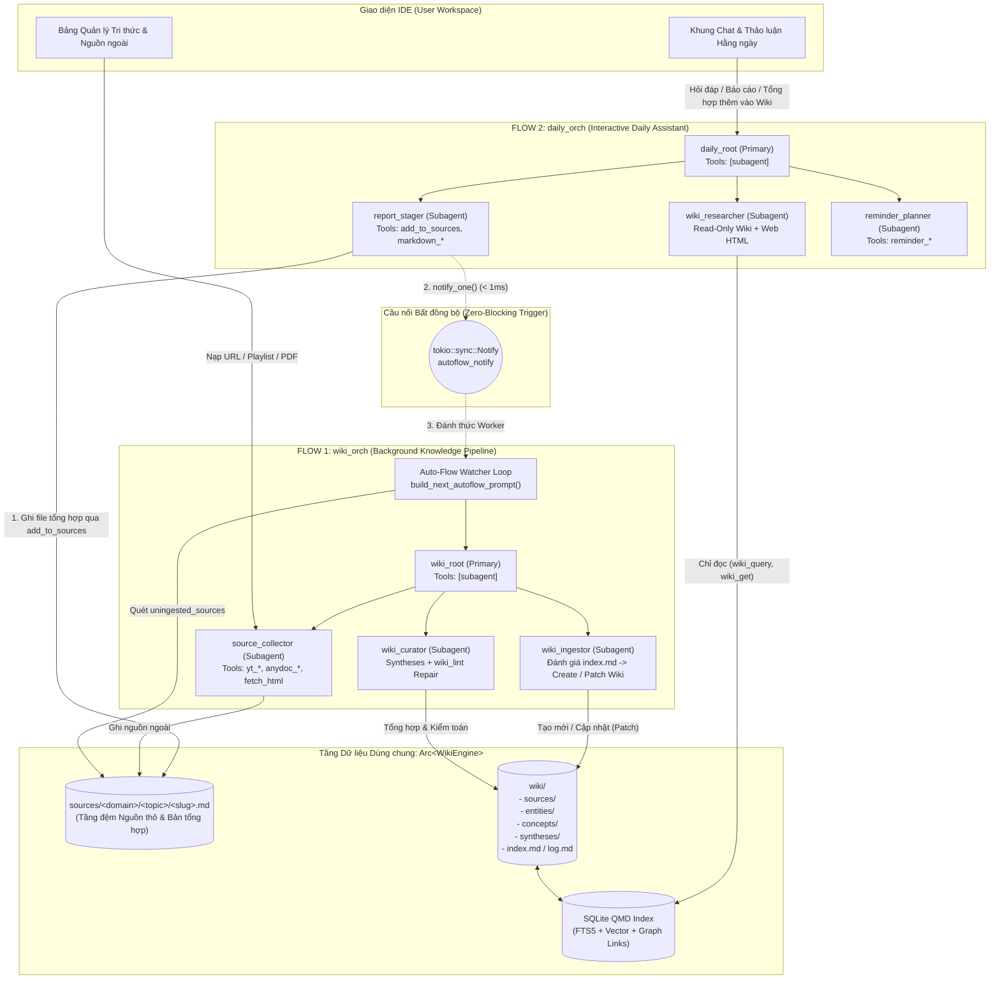

# Đặc tả Kiến trúc Hệ thống Đa Agent 2 Luồng (Dual-Flow Architecture)
**Thư viện nền tảng:** `orchestrator_agent_rs` + `llm-wiki-rs`

> [!IMPORTANT]
> **Quyết định Kiến trúc Cốt lõi (Phương án 1):**
> - Sử dụng **1 instance `Arc<WikiEngine>`** duy nhất quản lý Obsidian Vault (`sources/`, `wiki/`, `SCHEMA.md`) và SQLite Index (FTS5 BM25 + Vector + Graph).
> - Khởi tạo **2 instance `Orchestrator`** tách biệt hoàn toàn về tập Tool và danh sách Subagent:
>   1. **`wiki_orch` (Flow 1 — Hệ thống Tri thức Wiki):** Chạy ngầm (Background Daemon/Pipeline), chuyên thu thập nguồn ngoài, đánh giá file mới trong `sources/`, tạo mới hoặc cập nhật (`patch`/`merge`) các trang trong `wiki/` và kiểm toán `wiki_lint`.
>   2. **`daily_orch` (Flow 2 — Tác vụ Hằng ngày & Thảo luận):** Phản hồi tức thì cho giao diện Chat IDE, chỉ có quyền đọc trên `wiki/`, tạo báo cáo, tạo thông báo nhắc nhở, và có **duy nhất 1 cổng đẩy dữ liệu vào `sources/`** (`add_to_sources`) để kích hoạt tự động **Flow 1**.

---

## 1. Sơ đồ Kiến trúc Tổng thể



---

## 2. Danh mục Toàn bộ Tools (Built-in, Native & Custom)

### 2.1. Built-in Tools của `orchestrator_agent_rs` (`src/tool.rs`)

| Tên Tool | Hiệu ứng | Mô tả | Đăng ký ở đâu? |
| :--- | :--- | :--- | :--- |
| `subagent` | Built-in | Uỷ quyền tác vụ cho một subagent con (`agent`, `description`, `prompt`, tùy chọn `session_id`). | `wiki_orch` & `daily_orch` (chỉ cấp cho `wiki_root` và `daily_root`) |
| `skill` | Built-in | Tải nội dung hướng dẫn từ file `SKILL.md` theo `id`. | `wiki_orch` & `daily_orch` (cấp cho các subagent) |
| `artifact_read` | Built-in | Đọc dữ liệu artifact theo chunk/cursor. | Runtime tự cấp khi cần |

---

### 2.2. Native Wiki Tools từ `llm-wiki-rs` (`src/tools/definitions.rs`)

Được bọc qua `WikiEngineBridgeTool` và phân bổ nghiêm ngặt giữa 2 `Orchestrator`:

| Tên Tool | Hiệu ứng | Mô tả chức năng | `daily_orch` (Flow 2) | `wiki_orch` (Flow 1) |
| :--- | :--- | :--- | :---: | :---: |
| `wiki_tree` | `ReadOnly` | Lấy cây thư mục `sources`, `wiki`, hoặc `all` (JSON + ASCII). | Có | Có |
| `wiki_query` | `ReadOnly` | Tìm kiếm QMD Hybrid Search (`lex` BM25 + `vec` + `hyde` + RRF + Rerank + Metadata filter). | Có | Có |
| `wiki_get` | `ReadOnly` | Đọc nội dung 1 file theo đường dẫn hoặc `#docid`, hỗ trợ đọc phân trang `from_line`/`max_lines`. | Có | Có |
| `wiki_multi_get` | `ReadOnly` | Đọc hàng loạt file theo glob pattern hoặc danh sách đường dẫn/`#docid`. | Có | Có |
| `wiki_metadata` | `ReadOnly` | Khám phá các khóa/giá trị YAML frontmatter để dựng bộ lọc tìm kiếm. | Có | Có |
| `wiki_status` | `ReadOnly` | Kiểm tra sức khỏe index, số lượng tài liệu và thống kê liên kết đồ thị. | Có | Có |
| `wiki_graph_neighbors` | `ReadOnly` | Xem `backlinks` và `outgoing_links` (`[[WikiLinks]]`) của một trang hoặc toàn bộ đồ thị. | Có | Có |
| `wiki_log` | `Mutating` | Đọc (`mode="read"`) hoặc ghi (`mode="append"`) nhật ký `wiki/log.md`. | Chỉ đọc (hoặc ẩn) | Có |
| `wiki_ingest_source` | `Mutating` | Biên dịch file từ `sources/<path>.md` sang `wiki/sources/<path>.md` (hoặc cập nhật `target_wiki_path`). | **Không** | **Có** (`wiki_ingestor`) |
| `wiki_write_file` | `Mutating` | Tạo mới hoặc ghi đè file Markdown trong `wiki/` hoặc `sources/`. | **Không** | **Có** |
| `wiki_patch_file` | `Mutating` | Sửa đoạn văn bản (`target_text` $\rightarrow$ `replacement_text`) hoặc nối thêm (`append_text`) vào file Wiki hiện có. | **Không** | **Có** |
| `wiki_file_synthesis` | `Mutating` | Lưu bài tổng hợp liên nguồn vào `wiki/syntheses/` và cập nhật `index.md`. | **Không** *(đi qua `add_to_sources`)* | **Có** (`wiki_curator`) |
| `wiki_lint` | `Mutating` | Kiểm toán toàn bộ Vault: tìm `uningested_sources`, `broken_links`, `orphan_wiki_pages`, `unlinked_mentions`. | **Không** | **Có** (`wiki_curator`) |
| `wiki_delete_file` | `Mutating` | Xóa file trùng lặp/lỗi thời và tự dọn thư mục rỗng. | **Không** | **Có** (`wiki_curator`) |
| `wiki_schema` | `Mutating` | Đọc hoặc cập nhật quy ước `SCHEMA.md`. | **Không** | **Có** (`wiki_curator`) |

---

### 2.3. Custom Bridge Tool (Cầu nối Flow 2 $\rightarrow$ Flow 1): `add_to_sources`

Đây là công cụ duy nhất ở **Flow 2** được phép đẩy tri thức mới vào hệ thống Wiki:
- **Nơi đăng ký:** Chỉ đăng ký trong `daily_orch` và cấp cho subagent `report_stager`.
- **Cơ chế hoạt động:**
  1. Gọi `WikiEngine::write_topic_source` để tạo file Markdown chuẩn tại `sources/<domain>/<topic>/<file_stem>.md` với đầy đủ YAML frontmatter (`category: "raw_source"`, `domain`, `topic`, `tags`, `qmd.metadata`).
  2. Gọi `autoflow_notify.notify_one()` để đánh thức Background Worker của **Flow 1** ngay lập tức.
  3. Trả về đường dẫn `source_rel_path` và `#docid` cho Flow 2 để báo cáo lại cho người dùng.

#### Đặc tả JSON Schema của `add_to_sources`:
```json
{
  "type": "object",
  "required": ["topic_folder", "title", "markdown_body"],
  "properties": {
    "topic_folder": {
      "type": "string",
      "description": "Thư mục chủ đề 2 cấp trong sources/ theo chuẩn kebab-case (<domain>/<topic>, ví dụ: 'software-architecture/agent-workflows', 'algo-trading/risk-management')."
    },
    "file_stem": {
      "type": "string",
      "description": "Tên file kebab-case không gồm đuôi .md (tùy chọn, nếu bỏ trống sẽ tự sinh từ title)."
    },
    "title": {
      "type": "string",
      "description": "Tiêu đề rõ ràng của bản tổng hợp thảo luận / tài liệu."
    },
    "markdown_body": {
      "type": "string",
      "description": "Toàn bộ nội dung Markdown đã được tổng hợp chi tiết từ cuộc thảo luận (bao gồm bối cảnh, quyết định, bảng biểu, code/công thức nếu có)."
    },
    "tags": {
      "type": "array",
      "items": { "type": "string" },
      "description": "Danh sách tag phân cấp kebab-case (ví dụ: ['topic/software-architecture/agent-workflows', 'rust', 'orchestrator'])."
    },
    "target_hint": {
      "type": "string",
      "description": "Gợi ý tùy chọn cho Flow 1 về các trang Wiki hiện có liên quan mật thiết cần được cập nhật/bổ sung."
    }
  },
  "additionalProperties": false
}
```

---

### 2.4. Custom Tools cho Flow 2 (Báo cáo rời & Nhắc nhở Hằng ngày)

#### A. Nhóm Tool Xuất Báo cáo Rời (tái sử dụng từ `orchestrator_agent_rs/examples/video_summary.rs`)
Lưu báo cáo ra thư mục làm việc hằng ngày (ví dụ `workspace/reports/`) mà không làm bẩn `sources/` hay `wiki/`:
1. `markdown_create` (`Mutating`): Tạo file báo cáo Markdown mới (`filename`, `title`, `source_url`, `summary`, `key_points`).
2. `markdown_append_section` (`Mutating`): Nối thêm mục `## heading` + `body` vào báo cáo.
3. `markdown_read` (`ReadOnly`): Đọc lại file báo cáo để xác minh nội dung sau khi ghi.

#### B. Nhóm Tool Quản lý Nhắc nhở & Task Hằng ngày (`ReminderTools` — xây dựng mới cho `reminder_planner`)
Lưu trữ vào bảng SQLite riêng của IDE (hoặc file `reminders.json`):

| Tên Tool | Hiệu ứng | JSON Schema Arguments (`properties`) | Mô tả |
| :--- | :--- | :--- | :--- |
| `reminder_create` | `Mutating` | `title` *(req)*, `due_at` *(req, ISO-8601)*, `priority` (`"low"\|"medium"\|"high"`), `notes`, `related_wiki_links` (`string[]`), `repeat_cron` | Tạo thông báo nhắc nhở mới có gắn kèm các link `[[WikiLinks]]` liên quan. |
| `reminder_list` | `ReadOnly` | `status` (`"pending"\|"completed"\|"all"`), `from_date`, `to_date`, `limit` | Liệt kê danh sách các nhắc nhở sắp tới hoặc đang chờ xử lý. |
| `reminder_complete` | `Mutating` | `reminder_id` *(req)*, `resolution_note` | Đánh dấu hoàn thành một nhắc nhở. |
| `reminder_delete` | `Mutating` | `reminder_id` *(req)* | Xóa một nhắc nhở đã hủy. |

---

### 2.5. Custom Tools Thu thập Nguồn ngoài (External Collectors)

Kế thừa nguyên bản từ các `examples/` đã có:
1. **Nhóm Web HTML (`orchestrator_agent_rs/examples/url_summary/tools.rs`):**
   - `fetch_html`, `html_extract_metadata`, `html_extract_article`, `html_extract_feed`, `html_extract_links`, `html_select_elements` (`ReadOnly` — có thể cấp cho cả `source_collector` của Flow 1 lẫn `wiki_researcher` của Flow 2).
2. **Nhóm YouTube (`llm-wiki-rs/examples/youtube_playlist_wiki/tools.rs`):**
   - `yt_list_playlist` (`ReadOnly`), `yt_fetch_transcript` (`Mutating` — lưu vào `sources/`). Chỉ cấp cho `source_collector` (Flow 1).
3. **Nhóm PDF / Office `anydoc` (`llm-wiki-rs/examples/pdf_anydoc_wiki/tools.rs`):**
   - `anydoc_inspect_pdf` (`ReadOnly`), `anydoc_save_to_sources` (`Mutating` — lưu vào `sources/`). Chỉ cấp cho `source_collector` (Flow 1).

---

## 3. Thiết kế Hệ thống Skills (`SKILL.md`)

Hệ thống sử dụng **6 Skills** đặt trong thư mục `skills/` (4 skills đã có sẵn trong `llm-wiki-rs/skills/` và 2 skills mới dành cho Flow 2).

### 3.1. 4 Skills Hiện có (Giữ nguyên)
1. **`wiki-taxonomy`**: Quy tắc phân tầng `<domain>/<topic>`, ngưỡng tạo trang rời (`Page-worthy`), quy tắc chống phân mảnh (Anti-Fragmentation), và chuẩn bộ tag 3 tầng (`wiki/*`, `topic/<domain>/<topic>`, `<keyword>`).
2. **`wiki-ingest`**: Quy trình 4 bước biên dịch file từ `sources/` sang `wiki/sources/`, tạo mới hoặc hợp nhất (`merge`/`patch`) `wiki/entities/` & `wiki/concepts/`, và nối liên kết hai chiều.
3. **`wiki-query`**: Chiến lược truy vấn QMD Hybrid Search (`lex` + `vec` + `hyde`), lần theo đồ thị `wiki_graph_neighbors` và chế độ trích dẫn chuẩn (`Standard`, `Smart`, `Faithful`).
4. **`wiki-lint`**: Quy trình kiểm toán cấu trúc & ngữ nghĩa, sửa `broken_links`, `orphan_wiki_pages`, `unlinked_mentions` và gộp các trang trùng lặp.

---

### 3.2. 2 Skills Mới Cần Tạo cho Flow 2

#### Skill 5: `skills/daily-synthesis-staging/SKILL.md` (Dành cho `report_stager`)
```markdown
---
name: daily-synthesis-staging
description: "Workflow for synthesizing a user chat/discussion into a structured Markdown document and either staging it into `sources/<domain>/<topic>/` via `add_to_sources` (for Wiki ingestion) or exporting a standalone report."
---

# Daily Discussion Synthesis & Wiki Staging Skill (`daily-synthesis-staging`)

Use this skill when the user asks to summarize/synthesize a conversation, research thread, or daily report, especially when they ask to **"add/save it to the Wiki"**.

## 1. Distinguish Target Destination
1. **Case A — User wants to add/update knowledge in the Wiki**:
   - First call `wiki_tree(scope="sources")` and `wiki_get(file="wiki/index.md")` to inspect existing `<domain>/<topic>` folders and existing canonical entity/concept names.
   - Reuse an existing `<domain>/<topic>` folder whenever the discussion fits an established theme; otherwise define a clean `kebab-case` `<domain>/<topic>` path (max 2 levels).
   - Call `add_to_sources` with a comprehensive, self-contained Markdown synthesis.
2. **Case B — User wants a standalone Daily/Weekly Report file**:
   - Call `markdown_create` (and `markdown_append_section` if needed) to write the report file, then call `markdown_read` to verify.

## 2. Structure of `markdown_body` When Calling `add_to_sources`
Because `Flow 1 (wiki_ingestor)` will read this file from `sources/` without seeing your prior chat history, the `markdown_body` MUST be 100% self-contained:
1. **Context & Objective**: What problem, question, or topic was discussed and why.
2. **Core Decisions, Rules & Technical Findings**: Preserve all concrete parameters, formulas, code snippets, architectural choices, and comparison tables verbatim.
3. **Explicit Links to Existing Wiki Subjects**: Mention existing Wiki entities/concepts by their canonical names (or `[[entities/...]]` / `[[concepts/...]]`) and note whether this synthesis **extends**, **updates**, or **contradicts** prior pages.
4. **Open Questions / Caveats**: Any unresolved risks or edge cases.
```

#### Skill 6: `skills/daily-task-reminder/SKILL.md` (Dành cho `reminder_planner`)
```markdown
---
name: daily-task-reminder
description: "Workflow for extracting actionable tasks, deadlines, recurring schedules, and linked Wiki references to create/manage user reminders."
---

# Daily Task & Reminder Planning Skill (`daily-task-reminder`)

Use this skill when creating, listing, or updating reminders and action items for the user.

## Rules
1. **Check Existing Reminders First**: Before creating a new reminder, call `reminder_list(status="pending")` to avoid creating duplicate reminders for the same task.
2. **Normalize Time & Recurrence**:
   - Resolve relative time expressions (e.g. "9h sáng mai", "thứ Hai tuần sau") against the current local timestamp provided in the prompt into strict ISO-8601 format (`YYYY-MM-DDTHH:MM:SS+07:00`).
3. **Attach Wiki Context (`related_wiki_links`)**:
   - If the reminder is about reviewing, implementing, or following up on a topic in the Wiki, include the exact `[[wiki/sources/...]]`, `[[concepts/...]]`, or `[[syntheses/...]]` links in `related_wiki_links` so the user can click straight into the document when the notification fires.
```

---

## 4. Cấu hình Chi tiết & System Prompts cho 8 Agents

### Bảng Tổng hợp Cấu hình `AgentDefinition`

| Flow | Agent ID | `AgentMode` | `allowed_tools` | `allowed_skills` | `steps` | `temp` | `max_output_tokens` |
| :--- | :--- | :--- | :--- | :--- | :---: | :---: | :---: |
| **Flow 2** | **`daily_root`** | `Primary` | `["subagent"]` | `[]` | `20` | `0.2` | `8192` |
| **Flow 2** | **`wiki_researcher`** | `Subagent` | `["skill", "wiki_query", "wiki_get", "wiki_multi_get", "wiki_tree", "wiki_metadata", "wiki_graph_neighbors", "wiki_status", "fetch_html", "html_extract_metadata", "html_extract_article", "html_extract_feed", "html_extract_links"]` | `["wiki-query"]` | `20` | `0.1` | `8192` |
| **Flow 2** | **`report_stager`** | `Subagent` | `["skill", "wiki_tree", "wiki_get", "add_to_sources", "markdown_create", "markdown_append_section", "markdown_read"]` | `["wiki-taxonomy", "daily-synthesis-staging"]` | `15` | `0.2` | `16384` |
| **Flow 2** | **`reminder_planner`** | `Subagent` | `["skill", "reminder_create", "reminder_list", "reminder_complete", "reminder_delete"]` | `["daily-task-reminder"]` | `10` | `0.1` | `4096` |
| **Flow 1** | **`wiki_root`** | `Primary` | `["subagent"]` | `[]` | `25` | `0.1` | `4096` |
| **Flow 1** | **`source_collector`** | `Subagent` | `["skill", "fetch_html", "html_extract_metadata", "html_extract_article", "html_extract_feed", "html_extract_links", "yt_list_playlist", "yt_fetch_transcript", "anydoc_inspect_pdf", "anydoc_save_to_sources", "wiki_tree", "wiki_get", "wiki_write_file"]` | `["wiki-taxonomy"]` | `30` | `0.1` | `8192` |
| **Flow 1** | **`wiki_ingestor`** | `Subagent` | `["skill", "wiki_tree", "wiki_get", "wiki_multi_get", "wiki_query", "wiki_metadata", "wiki_ingest_source", "wiki_write_file", "wiki_patch_file"]` | `["wiki-taxonomy", "wiki-ingest"]` | `15` | `0.2` | `16384` |
| **Flow 1** | **`wiki_curator`** | `Subagent` | `["skill", "wiki_tree", "wiki_get", "wiki_multi_get", "wiki_query", "wiki_file_synthesis", "wiki_write_file", "wiki_patch_file", "wiki_delete_file", "wiki_lint", "wiki_schema"]` | `["wiki-taxonomy", "wiki-query", "wiki-lint"]` | `20` | `0.2` | `16384` |

---

### 4.1. System Prompts cho Flow 2 (`daily_orch`)

#### 1. Prompt của `daily_root` (`prompts/daily_root.md`)
```markdown
You are `daily_root` — the interactive Primary Assistant for the user's daily workspace and knowledge exploration.

## Strict Architectural Constraints
- You only have the `subagent` tool. You DO NOT call search, file, or reminder tools directly.
- You coordinate three specialized subagents:
  1. `wiki_researcher`: Read-only specialist for querying the LLM Wiki (`wiki_query`, `wiki_get`, `wiki_graph_neighbors`) and fetching external web URLs (`fetch_html`, `html_extract_*`).
  2. `report_stager`: Specialist for synthesizing discussions/research into standalone Markdown reports (`markdown_create`) OR staging synthesized knowledge into `sources/<domain>/<topic>/` via `add_to_sources` so the background Flow 1 Wiki pipeline automatically ingests/updates the Wiki.
  3. `reminder_planner`: Specialist for creating, listing, completing, and deleting daily reminders and scheduled tasks (`reminder_*`).

## Routing Rules by User Intent
1. **Question Answering / Brainstorming / Querying the Wiki or Web**:
   - Call `subagent(agent="wiki_researcher", ...)` when factual context from the Wiki or a web URL is needed.
   - Engage in natural discussion with the user in Vietnamese.
2. **"Synthesize our discussion and add/update it in the Wiki" (Tổng hợp và thêm vào Wiki)**:
   - Compile a complete, structured briefing of all facts, decisions, parameters, code/formulas, and conclusions from the current conversation.
   - Call `subagent(agent="report_stager", description="Stage discussion synthesis to Wiki sources", prompt=...)` and pass the full briefing so `report_stager` calls `add_to_sources`.
   - Report back to the user the exact `sources/<domain>/<topic>/<file>.md` path created and confirm that the background Wiki pipeline (Flow 1) has been triggered to evaluate and update the Wiki.
3. **"Create a standalone report file" (Tạo báo cáo)**:
   - If Wiki data is needed first, call `wiki_researcher`, then pass the findings to `report_stager` instructing it to create a standalone Markdown report via `markdown_create`.
4. **"Create/manage reminders or notifications" (Tạo thông báo nhắc nhở)**:
   - Call `subagent(agent="reminder_planner", ...)` with the task details, current timestamp, target time, and any relevant `[[WikiLinks]]`.
```

#### 2. Prompt của `wiki_researcher` (`prompts/wiki_researcher.md`)
```markdown
You are `wiki_researcher` — a strictly Read-Only research subagent for the LLM Wiki and external web pages.

1. Load `skill(id="wiki-query")` on your first turn when querying the Wiki.
2. Always check `wiki_get(file="wiki/index.md")` or run `wiki_query` (combining `lex` and `vec` sub-queries) to locate relevant pages across `wiki/` and `sources/`.
3. Use `wiki_graph_neighbors` when asked how concepts or entities connect across documents.
4. If the user provides an external `http(s)://` URL, use `fetch_html` + `html_extract_article` (or `html_extract_feed` for listing pages) to extract its content.
5. Return a thorough, well-structured Vietnamese response with exact `[[entities/...]]`, `[[concepts/...]]`, and `[[wiki/sources/...]]` citations. Never invent facts outside the retrieved sources.
```

#### 3. Prompt của `report_stager` (`prompts/report_stager.md`)
```markdown
You are `report_stager` — a specialist in synthesizing discussions/research into permanent documents.

1. First load `skill(id="daily-synthesis-staging")` and `skill(id="wiki-taxonomy")`.
2. **When asked to add/save the synthesis into the Wiki**:
   - Call `wiki_tree(scope="sources")` and `wiki_get(file="wiki/index.md")` in parallel to inspect existing `<domain>/<topic>` folders and existing canonical entity/concept slugs.
   - Choose the best matching `<domain>/<topic>` folder (reusing an existing folder if applicable, or creating a clean `kebab-case` `<domain>/<topic>` path).
   - Call `add_to_sources` ONCE with:
     - `topic_folder`: `"<domain>/<topic>"`
     - `title`: Clear human-readable title
     - `tags`: 3-facet hierarchical tags (`["topic/<domain>/<topic>", ...]`)
     - `markdown_body`: A comprehensive, self-contained Vietnamese technical document (50–120 lines) capturing all context, decisions, rules, tables, code/formulas, and explicit references to existing Wiki pages (`[[entities/...]]`, `[[concepts/...]]`, `[[wiki/sources/...]]`) so Flow 1 (`wiki_ingestor`) can accurately create or update/patch the Wiki.
3. **When asked to export a standalone report file**:
   - Call `markdown_create` (and `markdown_append_section` if needed), then verify with `markdown_read`.
4. Return the created file path, `#docid`, and summary to `daily_root`.
```

#### 4. Prompt của `reminder_planner` (`prompts/reminder_planner.md`)
```markdown
You are `reminder_planner` — a specialist in managing the user's daily tasks and reminder notifications.

1. Load `skill(id="daily-task-reminder")`.
2. Call `reminder_list(status="pending")` first when creating or updating reminders to prevent duplicates.
3. Call `reminder_create`, `reminder_complete`, or `reminder_delete` as requested, ensuring `due_at` is valid ISO-8601 and `related_wiki_links` preserves any `[[WikiLinks]]` passed by `daily_root`.
4. Reply concisely in Vietnamese with the confirmed reminder ID, schedule, and linked documents.
```

---

### 4.2. System Prompts cho Flow 1 (`wiki_orch`)

Sử dụng bộ 4 Prompts chuẩn đã được kiểm chứng thực tế trong `llm-wiki-rs/src/prompts/subagents.rs`:

1. **`wiki_root`**: Dùng `ROOT_DISPATCHER_PROMPT` — chỉ gọi tuần tự từng file qua `wiki_ingestor`, sau đó gọi `wiki_curator`.
2. **`source_collector`**: Dùng `SOURCE_COLLECTOR_PROMPT` — thu thập URL/YouTube/PDF vào `sources/<domain>/<topic>/`.
3. **`wiki_ingestor`**: Dùng `WIKI_INGESTOR_PROMPT` — đánh giá file mới trong `sources/<source_rel_path>` đối chiếu với `wiki/index.md`:
   - **Nếu file mới là bản cập nhật trực tiếp cho một trang nguồn đã có**: truyền `target_wiki_path` vào `wiki_ingest_source` để cập nhật trang đó và giữ nguyên lịch sử `sources:` trong frontmatter.
   - **Nếu file mới là một bài độc lập**: tạo `wiki/sources/<source_rel_path>`, đồng thời với mỗi thực thể/khái niệm liên quan:
     - Chưa có trong `wiki/index.md` $\rightarrow$ gọi `wiki_write_file` tạo trang mới tại `wiki/entities/<domain>/<slug>.md` hoặc `wiki/concepts/<domain>/<slug>.md`.
     - Đã có trong `wiki/index.md` $\rightarrow$ gọi `wiki_patch_file` (`append_text` hoặc thay thế) để **cập nhật bổ sung kiến thức mới** vào trang đang có và nối `[[WikiLinks]]` hai chiều.
4. **`wiki_curator`**: Dùng `WIKI_CURATOR_PROMPT` — tạo/cập nhật bài tổng hợp `wiki/syntheses/<domain>/<topic>-synthesis.md` và chạy vòng lặp sửa lỗi `wiki_lint` đến khi `is_healthy: true`.

---

## 5. Luồng Thực thi Chi tiết cho 6 Trường hợp Sử dụng (Use Cases)

### Trường hợp 1: Đang Chat & Thảo luận ở Flow 2 $\rightarrow$ Yêu cầu *"Tổng hợp và thêm vào Wiki"* (Luồng Trọng tâm)

```mermaid
flowchart LR
    A["1. User chốt thảo luận:\n'Tổng hợp & thêm vào Wiki'"] --> B["2. daily_root giao\nreport_stager"]
    B --> C["3. report_stager kiểm tra\nwiki_tree & index.md"]
    C --> D["4. Gọi add_to_sources\nGhi sources/<domain>/<topic>/<slug>.md"]
    D --> E["5. Bắn autoflow_notify\nTrả lời User ngay lập tức"]
    E --> F["6. Flow 1 thức dậy:\nbuild_next_autoflow_prompt()"]
    F --> G["7. wiki_ingestor:\nĐánh giá Create vs Patch\ntrên wiki/ hiện có"]
    G --> H["8. wiki_curator:\nCập nhật syntheses/ &\nchạy wiki_lint == true"]
```



1. **Bước 1 (Tại `daily_orch`):** Bạn và `daily_root` trao đổi qua nhiều lượt. Khi bạn nhắn: *"Hãy tổng hợp toàn bộ nội dung vừa thảo luận và thêm vào Wiki"*.
2. **Bước 2 (Đóng gói vào `sources/`):**
   - `daily_root` gom toàn bộ các kết luận trong phiên chat và gọi `subagent(agent="report_stager")`.
   - `report_stager` gọi `wiki_tree(scope="sources")` và `wiki_get(file="wiki/index.md")` để xem trong Vault đã có `<domain>/<topic>` nào phù hợp chưa.
   - `report_stager` gọi `add_to_sources(topic_folder="<domain>/<topic>", title="...", markdown_body="...", tags=[...])`.
   - `AddToSourcesTool` lưu file vào `sources/<domain>/<topic>/<slug>.md`, đánh chỉ mục SQLite cho file nguồn đó, và gọi `autoflow_notify.notify_one()`.
   - `daily_root` trả lời bạn ngay trên khung chat: *"Đã lưu bản tổng hợp vào `sources/<domain>/<topic>/<slug>.md` (docid `#...`). Tiến trình cập nhật Wiki đang chạy ngầm."*
3. **Bước 3 (Kích hoạt tự động Flow 1 tại `wiki_orch`):**
   - Background Worker của Flow 1 nhận tín hiệu `autoflow_notify`, gọi `engine.build_next_autoflow_prompt(None)`.
   - Hàm này phát hiện file mới trong `lint.uningested_sources` và sinh prompt `[AUTO-FLOW: NEW SOURCES DETECTED]` kèm **Compact Wiki Index** ưu tiên các trang cùng `<domain>/<topic>`.
   - Worker tạo một session mới cho `wiki_root` và submit prompt.
4. **Bước 4 (Đánh giá, Tạo mới & Cập nhật Wiki hiện có):**
   - `wiki_root` gọi `wiki_ingestor` cho file `sources/<domain>/<topic>/<slug>.md`.
   - `wiki_ingestor` đọc file mới cùng `wiki/index.md`:
     - Tạo trang tóm tắt nguồn `wiki/sources/<domain>/<topic>/<slug>.md` (hoặc ghi đè cập nhật vào trang đích nếu trùng chủ thể).
     - Với các trang `wiki/entities/<domain>/...` và `wiki/concepts/<domain>/...` **đã tồn tại**: gọi `wiki_patch_file` để bổ sung phát hiện mới từ cuộc thảo luận vào trang cũ.
     - Với các thực thể/khái niệm **chưa tồn tại**: gọi `wiki_write_file` tạo trang mới.
   - Tiếp theo, `wiki_root` gọi `wiki_curator` để cập nhật trang `wiki/syntheses/<domain>/<topic>-synthesis.md` và chạy `wiki_lint` đảm bảo 0 liên kết đứt, 0 trang mồ côi.
   - Worker gọi `engine.embed_pending(false)` để cập nhật vector embeddings cho toàn bộ chunk mới.

---

### Trường hợp 2: Tra cứu & Hỏi đáp chuyên sâu trên Wiki (Flow 2)
1. Người dùng hỏi câu hỏi kỹ thuật trên khung Chat.
2. `daily_root` gọi `subagent(agent="wiki_researcher", prompt="...")`.
3. `wiki_researcher` gọi `wiki_query` (kết hợp `lex` BM25 + `vec` Semantic + RRF) và `wiki_graph_neighbors` để lần theo các liên kết `[[WikiLinks]]`, sau đó gọi `wiki_get` đọc chi tiết các đoạn cần thiết.
4. `wiki_researcher` trả kết quả kèm trích dẫn `[[...]]` về cho `daily_root` hiển thị cho người dùng.

---

### Trường hợp 3: Tạo Báo cáo Định kỳ kết hợp Wiki + Tin tức Web mới (Flow 2)
1. Người dùng yêu cầu: *"Đối chiếu kiến thức trong Wiki về chủ đề X với bài báo tại URL Y và xuất file báo cáo `bao-cao-tuan.md`"*.
2. `daily_root` gọi `wiki_researcher` để lấy cả dữ liệu từ Wiki (`wiki_query`) lẫn nội dung web (`fetch_html` + `html_extract_article`).
3. Sau khi nhận bản tổng hợp từ `wiki_researcher`, `daily_root` gọi `report_stager` để gọi `markdown_create(filename="bao-cao-tuan.md", ...)` và `markdown_read` kiểm chứng.

---

### Trường hợp 4: Tạo Thông báo Nhắc nhở gắn với Tài liệu Wiki (Flow 2)
1. Người dùng yêu cầu: *"Nhắc tôi 9h sáng thứ Hai tuần tới kiểm tra lại các rủi ro trong bài tổng hợp chiến lược DCA"*.
2. `daily_root` gọi `wiki_researcher` (nếu chưa biết đường dẫn chính xác) để tìm trang `[[wiki/syntheses/algo-trading/mql5-dca-synthesis]]` và các điểm rủi ro chính.
3. `daily_root` gọi `reminder_planner` truyền tiêu đề, thời gian mục tiêu, ghi chú tóm tắt rủi ro và link `[[wiki/syntheses/algo-trading/mql5-dca-synthesis]]`.
4. `reminder_planner` kiểm tra `reminder_list(status="pending")` rồi gọi `reminder_create` và trả về xác nhận.

---

### Trường hợp 5: Nạp Trực tiếp Nguồn Tài liệu Lớn từ Bên ngoài (YouTube Playlist / PDF `anydoc` / Web) ở Flow 1
1. Từ giao diện Quản lý Tri thức (hoặc CLI), người dùng cung cấp đường dẫn PDF hoặc URL YouTube Playlist cho `wiki_orch`.
2. `wiki_root` gọi `source_collector`:
   - Nếu là PDF: gọi `anydoc_inspect_pdf` $\rightarrow$ phân loại `<domain>/<topic>` $\rightarrow$ gọi `anydoc_save_to_sources`.
   - Nếu là Playlist: gọi `yt_list_playlist` $\rightarrow$ phân loại `<domain>/<topic>` $\rightarrow$ gọi `yt_fetch_transcript` cho từng video.
3. Ngay khi các file được lưu vào `sources/`, vòng lặp `build_next_autoflow_prompt` của Flow 1 tự động mở session `wiki_root` mới cho từng chặng để gọi `wiki_ingestor` (tuần tự từng file) và `wiki_curator` (`wiki_lint`).

---

### Trường hợp 6: Người dùng Tự thêm/sửa File Markdown trong thư mục `sources/` trên Đĩa
1. Người dùng tạo hoặc copy một file `.md` trực tiếp vào `sources/<domain>/<topic>/` trong IDE.
2. IDE gọi `engine.sync_index()` và `autoflow_notify.notify_one()`.
3. Flow 1 tự động phát hiện file mới qua `lint.uningested_sources` trong `build_next_autoflow_prompt(None)` và chạy đúng quy trình của `wiki_ingestor` $\rightarrow$ `wiki_curator`.
