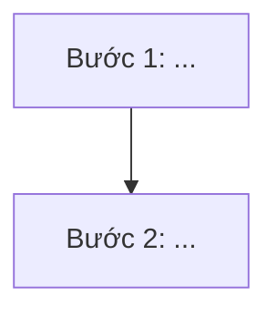

# Deep Video Wiki Ingest Skill

When assigned a YouTube video (`video_id`, `source_rel_path`, `title`), execute this exact workflow:

## Step 1: Inspect Current Wiki State
- Call `wiki_get(file="wiki/index.md")` to see all already-ingested video pages (`wiki/sources/youtube/...`), canonical `entities/`, and canonical `concepts/`.

## Step 2: Fetch Transcript & Create Raw Source (`sources/`)
- Call `yt_fetch_transcript` with `video_id`, `source_rel_path`, and `title`.
- This tool downloads the video subtitles via `yt-dlp`, saves the immutable raw source Markdown in `sources/<source_rel_path>`, and returns the full transcript text to you.

## Step 3: Write a Comprehensive, Deep Technical Wiki Page (`wiki_ingest_source`)
- Do NOT write a short, shallow summary! A 15,000–28,000 character transcript contains rich technical details, code walkthroughs, parameters, backtest metrics, and risk analysis.
- Call `wiki_ingest_source` with `source_rel_path`, `title`, `one_line_summary`, `tags`, `related_entities` (canonical slugs only!), `related_concepts` (canonical slugs only!), and a comprehensive `wiki_markdown_body` in Vietnamese (keeping English technical/code terms) structured with ALL of the following sections:

```markdown
## 1. Bối cảnh & Mục tiêu Video
- Giải thích rõ mục đích của video (4–6 câu chi tiết).
- Nếu trong `wiki/index.md` đã có các video khác của playlist, liên kết trực tiếp tới chúng bằng `[[wiki/sources/youtube/<stem>|<Tiêu đề>]]` và nêu rõ video này kế thừa, kiểm thử hay sửa lỗi gì cho các video đó.

## 2. Phân tích Kỹ thuật, Quy tắc Chiến lược & Logic Lập trình
- Trích xuất CHI TIẾT mọi quy tắc, thông số kỹ thuật, thuật toán và cấu trúc code xuất hiện trong transcript:
  - **Quy tắc vào lệnh / thoát lệnh / nhồi lệnh**: (ví dụ: khoảng cách lưới `%`, điều kiện nến, chu kỳ chỉ báo, khung thời gian `H1`/`D1`, số lượng vị thế tối đa trước khi nhân lot...).
  - **Cấu trúc Code / Kiến trúc Kỹ thuật**: (ví dụ: các class, hàm, biến input, cấu trúc vòng lặp `for`, cách quản lý handle chỉ báo, hoặc các bug cụ thể trong code đã được phát hiện và sửa như thế nào).
  - Liên kết trực tiếp tới các trang `[[entities/<slug>|...]]` và `[[concepts/<slug>|...]]` ngay trong dòng văn bản.

## 3. Thông số Cấu hình & Kết quả Kiểm thử (Backtest / Thực nghiệm)
- Liệt kê bảng hoặc danh sách chi tiết các kịch bản kiểm thử trong video:
  - Cặp tiền / Tài sản giao dịch (ví dụ `AUDJPY`, `EURNZD`, đa cặp tiền...), khung thời gian, giai đoạn dữ liệu (ví dụ 10 năm Tick Data).
  - Kết quả lợi nhuận (`%`), mức sụt giảm tài khoản (Drawdown), hiện tượng nhân đôi tài khoản (100% profit) so với cháy tài khoản (account crash).

## 4. Điểm Cốt lõi, Rủi ro & Phản biện (Key Takeaways & Caveats)
- 6–10 luận điểm đúc kết sâu sắc từ video.
- Bắt buộc có khối cảnh báo hoặc đối chiếu mâu thuẫn:
> [!WARNING] Contradiction / Caveat
> Nêu rõ giới hạn thực tế, rủi ro cháy tài khoản, sự khác biệt giữa đánh giá chủ quan của con người và thuật toán tự động, hoặc điểm mâu thuẫn với tuyên bố "99% winrate".

## 5. Sơ đồ Thuật toán & Luồng Thực thi

*(Bắt buộc bọc tất cả nhãn node trong dấu ngoặc kép `"..."`, nhiều dòng rõ ràng).*

## 6. Liên kết & Tiến trình Tri thức trong Wiki
- Liên kết tới các video liên quan trong `[[wiki/sources/youtube/...]]`, các `[[entities/...]]` và `[[concepts/...]]`.
```

## Step 4: Create or Update Canonical Entity & Concept Pages + Patch Existing Video Pages
1. For EVERY slug listed in `related_entities` (`wiki/entities/<slug>.md`) and `related_concepts` (`wiki/concepts/<slug>.md`):
   - Check if `wiki/entities/<slug>.md` or `wiki/concepts/<slug>.md` already exists in `wiki/index.md`.
   - If it **does not exist**, call `wiki_write_file` (`scope="wiki"`, `rel_path="entities/<slug>.md"` or `"concepts/<slug>.md"`) with full YAML frontmatter (`title`, `category: "entity"` or `"concept"`, `summary`, `aliases`, `tags`), a **true domain definition & technical explanation** (15–30 lines), and a `## Tham chiếu trong các Video` section linking to `[[wiki/sources/youtube/<this-stem>|<Title>]]` and `[[sources/youtube/<this-stem>|<this-stem>.md]]`.
   - If it **already exists**, call `wiki_get` to read it, then call `wiki_write_file` (or `wiki_patch_file`) to integrate the new technical insights from this video and append `- [[wiki/sources/youtube/<this-stem>|<Title>]] (Nguồn gốc: [[sources/youtube/<this-stem>|<this-stem>.md]]) — <vai trò trong video này>`.
2. If related video pages already exist in `wiki/sources/youtube/`, call `wiki_patch_file` on them (`append_text`) to add a cross-link to this newly ingested video!

